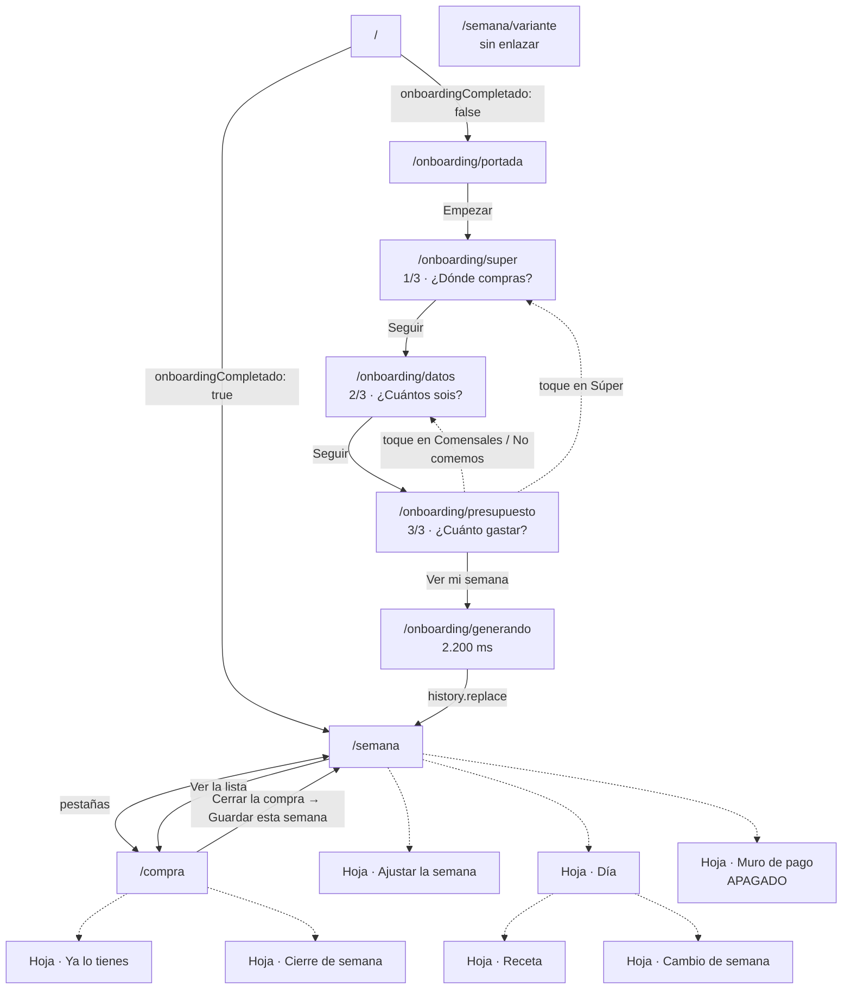

# Cunde · traspaso de diseño

## Nota para quien lee esto

**Este documento describe la app tal y como está construida hoy, no cómo se
pensó.** Todo lo que hay aquí sale de leer el código fuente: los textos, de los
`.tsx`; los colores, tamaños y áreas de toque, de `src/theme/tokens.css` y de
los `.css` de cada componente; el flujo, del enrutador; los estados, de las ramas
condicionales de cada pantalla; el modelo, de `src/state/types.ts` y
`src/motor/tipos.ts`.

Los textos entre comillas son **literales**. Cuando un texto es dinámico se
escribe la plantilla con llaves y debajo un ejemplo con números reales.

Este repositorio tiene comentarios largos que explican decisiones con datos
medidos, y son la mejor fuente del «por qué». Los cito con fichero y línea. Aun
así: **si algo te parece raro, pregunta antes de darlo por intencionado.** Hay
cosas que están así porque se midieron, y hay cosas que están así porque nadie
las ha vuelto a mirar. Este documento intenta distinguirlas, pero no siempre se
puede saber desde fuera.

La última sección recoge las **incoherencias que he encontrado dentro del propio
código**. No las he arreglado.

---

## Índice

- [A. Qué hace la app](#a-qué-hace-la-app)
- [B. Los principios que el código repite](#b-los-principios-que-el-código-repite)
- [C. El sistema visual, con los valores reales](#c-el-sistema-visual-con-los-valores-reales)
- [D. Qué no aparece en el código, y qué sí](#d-qué-no-aparece-en-el-código-y-qué-sí)
- [E. Mapa de pantallas](#e-mapa-de-pantallas)
- [F. Ficha por pantalla](#f-ficha-por-pantalla)
  - [F.1 Portada](#f1-portada--onboardingportada)
  - [F.2 Súper (1/3)](#f2-súper-13--onboardingsuper)
  - [F.3 Datos (2/3)](#f3-datos-23--onboardingdatos)
  - [F.4 Presupuesto (3/3)](#f4-presupuesto-33--onboardingpresupuesto)
  - [F.5 Generando](#f5-generando--onboardinggenerando)
  - [F.6 Semana](#f6-semana--semana)
  - [F.7 Compra](#f7-compra--compra)
  - [F.8 Semana variante](#f8-semana-variante--semanavariante)
- [G. Las hojas](#g-las-hojas)
  - [G.1 Ajustar la semana](#g1-ajustar-la-semana-dos-capas)
  - [G.2 Hoja del día](#g2-hoja-del-día)
  - [G.3 Ficha de receta](#g3-ficha-de-receta)
  - [G.4 Cambio de semana](#g4-cambio-de-semana)
  - [G.5 Cierre de semana](#g5-cierre-de-semana)
  - [G.6 Ya lo tienes](#g6-ya-lo-tienes)
  - [G.7 Muro de pago](#g7-muro-de-pago)
  - [G.8 Aviso de alérgenos](#g8-aviso-de-alérgenos-no-es-una-hoja)
- [H. El modelo que ve el usuario](#h-el-modelo-que-ve-el-usuario)
- [I. La voz](#i-la-voz)
- [J. Accesibilidad](#j-accesibilidad)
- [K. Restricciones técnicas que atan al diseño](#k-restricciones-técnicas-que-atan-al-diseño)
- [L. Lo que está a medias o sin decidir](#l-lo-que-está-a-medias-o-sin-decidir)
- [M. Incoherencias dentro del código](#m-incoherencias-dentro-del-código)
- [Anexo · inventario de componentes](#anexo--inventario-de-componentes)

---

## A. Qué hace la app

El usuario dice cuántos son, dónde compra y cuánto quiere gastar a la semana. La
app le devuelve tres cosas: un menú de siete días, una lista de la compra con
productos y precios reales de Mercadona, y el total antes de salir de casa.
Luego se lleva la lista al súper, va marcando, y al terminar teclea lo que ha
marcado el ticket.

Todo el cálculo es **determinista y local**. Hay un motor completo en
`src/motor/` —`seleccionar.ts` pasa de las 1.800 líneas y tiene su propia batería
de tests— que elige recetas por coste marginal contra un catálogo real congelado
en `src/data/motor-datos.json`: **112 recetas, 114 SKU, 12 grupos de ensamblajes,
generado el 2026-07-28**. No hay red en tiempo de ejecución. No hay modelo de
lenguaje en ninguna parte del código de la app.

### La tesis, deducida del código

No hace falta creerlo de fe: el propio código lo dice en cinco sitios distintos.

- `src/pages/Semana.tsx:36-37` — «el bloque relleno era el segundo elemento más
  fuerte de la pantalla, a 40 px de la cifra grande, y **la regla del proyecto es
  que la cifra en euros es siempre el elemento más grande**».
- `src/pages/onboarding/Portada.tsx:24-27` — «La portada anterior incumplía la
  regla de que la cifra en euros es el elemento más grande de la pantalla — el
  suyo era un párrafo de cuatro líneas.»
- `src/components/AjustesSemana.tsx:209-210` — «**Es una app de dinero**, así que
  también aquí manda la cifra en euros.»
- `src/motor/postres.ts:86` — «Se ordena por lo que cuesta la ración —**es una
  app de dinero**— y se cogen los cuatro primeros.»
- `src/components/SelectorProteina.tsx:28-31` — «El precio **no** es el
  protagonista de este selector», y a continuación explica por qué **ese** es el
  caso excepcional y no la norma.

La consecuencia práctica, visible en cada pantalla: la cifra en euros es lo más
grande, y **no hay ni una foto de comida en las pantallas principales**. Las
fotos existen, pero solo dentro de dos hojas.

### Lo que diferencia el producto

`src/components/ElegirSuper.tsx:38-55` lo dice con datos medidos: el código
postal no está para acertar el precio (la misma cesta cuesta 144,50 € en A
Coruña y 145,54 € en Barcelona, un 0,7%, con cero variación en los 69 productos
envasados). Está para acertar la **referencia**: los filetes de vacuno son el SKU
8936 en Madrid y el 2900 en Sevilla; la dorada, 87300 en A Coruña y 81234.1 en
Sevilla. 25 de 108 SKU no existen en algún almacén, pero el ingrediente sí.

Es decir: el producto no vende «un menú». Vende que **el producto de la lista
existe en el lineal que el usuario tiene delante, con su precio**. Todo lo demás
del diseño está subordinado a eso.

### La función objetivo, según el motor

`src/motor/tipos.ts:181-217` define dos costes que no se mezclan nunca:

- **Coste de consumo** (`consumoCoste`, `totalConsumo`) — lo que el plato usa de
  verdad.
- **Coste de carrito** (`carritoCoste`, `totalCarrito`) — lo que pasa por caja,
  con los envases redondeados hacia arriba.

Y un tercero, `totalPerecedero`, que es la diferencia: lo que se compra y no se
come. `src/components/SelectorProteina.tsx:21-25` construye un selector entero
alrededor de ese número, con textos que describen el desperdicio y no el precio.
**Minimizar el desperdicio es lo que el motor optimiza**, no minimizar el gasto a
secas.

---

## B. Los principios que el código repite

No son una lista heredada: son las frases que aparecen una y otra vez en los
comentarios, cada una con su fichero.

**1. La cifra en euros manda en todas las pantallas.** Citado arriba, en cinco
ficheros. Incluso dentro de una hoja: `AjustesSemana.css:233-234` explica que el
total de la hoja va a 34 px y no a 56 «porque la de 56 está reservada al total de
la semana, y esta hoja vive encima de esa pantalla. Dos cifras de 56 compitiendo
sería no tener ninguna».

**2. Dos pestañas y nada más.** `src/components/TopTabs.tsx` solo pinta `SEMANA`
y `COMPRA`. Cuando hizo falta un tercer sitio para la despensa,
`src/pages/Compra.tsx:145-155` descartó explícitamente añadir una pestaña: «sería
*chrome* permanente para algo que se toca cuando te equivocas, una vez cada
varias semanas — y partiría el dinero en dos totales». Se resolvió con una hoja.

**3. Nunca el muro: siempre la salida.** Es el patrón más repetido de la app.
Aparece cuatro veces:

- `Presupuesto.tsx:97-119` — «Con 30 € no me salen las cuentas… Con 52 € sí» +
  botón que lo aplica.
- `Semana.tsx:280-334` — hasta tres salidas cuando la semana no cuadra.
- `Semana.tsx:336-353` — salidas cuando los filtros dejan el recetario corto,
  **sin borrar la semana anterior**.
- `SelectorCoste.tsx:36-39` — «Un nivel que no se puede montar sale marcado
  aquí, no falla al elegirlo. Dejar que se elija para luego enseñar un error es
  el muro por la puerta de atrás.»

`AppStateContext.tsx:63-68` lo formula entero: si las restricciones no dan para
llenar la semana, «NO se borra la semana que el usuario ya tiene delante: se
guarda el diagnóstico y la pantalla ofrece las salidas».

**4. El plan se rompe, y la app absorbe el fallo sin reñir.** La hoja del día
tiene tres acciones para deshacer cualquier hueco, y ninguna cuesta dinero.
`suscripcion.ts:72-75`: «Los tres retoques, sin límite… cobrar por rehacer el
martes es cobrar por cumplir nuestra propia promesa.»
`TarjetaDia.css:76-78`: una sobra «no se tacha ni se esconde — sigue siendo
comida y sigue tocándose, **porque el plan se rompe el martes** y hay que poder
deshacer la tanda».

**5. La pantalla Compra se usa de pie, con una mano, empujando un carro.**
Repetido literalmente en `Compra.tsx:47`, `Compra.tsx:150`, `Compra.css:182-183`,
`ShoppingRow.tsx:26-28`, `types.ts:90-92` y `data/motor.ts:257-259`. De ahí salen
la cabecera de pasillo que marca el pasillo entero, los dos controles separados
de la fila, y el borrado de la fecha del catálogo de las 27 filas.

**6. Sin conexión no es un caso excepcional, es el caso.**
`types.ts:135-137`: el almacén se conserva «porque la pantalla Compra funciona
sin conexión y ahí no se puede volver a preguntar».
`lib/compras.ts:69-74`: «Quien ha pagado y abre la app en el sótano del súper
—donde no hay cobertura, que es literalmente nuestro caso de uso— no puede perder
lo que ha pagado por eso.»

**7. Un número que se enseña tiene que ser verdad y tiene que moverse.**
`lib/consecuencias.ts:14-17`: «Regla de la casa: el número tiene que ser VERDAD y
tiene que MOVERSE. Un dato que no cambia al tocar es adorno, y un dato inventado
para que se mueva es peor que no ponerlo.»
`MuroDePago.tsx:11-13`: «Nunca un promedio del sector ni una cifra inventada: si
no hay dato real, no se enseña cifra.»
`SelectorVariedad.tsx:29-32`: se retiraron tres etiquetas porque «una de cada
tres veces la etiqueta contradiría lo que hay dentro, en una app cuya única
defensa es que sus números no mienten».

**8. La despensa va fuera del total.** `data/motor.ts:263` marca los productos de
despensa con `loTengo: true` de salida, y `lib/derive.ts:124-128` los excluye de
`totalLista` mientras esa marca esté puesta.

---

## C. El sistema visual, con los valores reales

El objeto que la app imita está dicho en `tokens.css:168-169` y en
`Datos.tsx:107-110`: **el ticket de una impresora térmica**. «Papel térmico es
tipografía, filetes y números.» «Un ticket no tiene iconos, y cualquier
pictograma al lado es un cuerpo extraño en un sistema que no tiene vocabulario
para ellos.» «Una impresora térmica es monoespaciada y no tiene tracking; un
ticket de verdad usa mayúsculas SIN espaciar.»

Todos los valores siguientes son los de `src/theme/tokens.css`, verificados.

### Paleta

| Token | Hex | Para qué se usa realmente |
|---|---|---|
| `--papel` | `#EFEDE6` | Fondo de `html`, `body`, `#root`, todas las pantallas y todas las hojas. |
| `--papel-2` | `#E5E2D8` | Franja de deshacer, aviso de alérgenos, aviso de presupuesto que no cuadra, carril de la barra de coste del día. |
| `--crema` | `#F6F4EE` | **Declarado y usado una sola vez.** Prácticamente muerto. |
| `--tinta` | `#1A1917` | Todo el texto principal. No es negro puro. |
| `--azulete` | `#2B4C7E` | Acciones: botón principal, enlaces, casillas marcadas, barras de progreso, foco, borde seleccionado. |
| `--azulete-fondo` | `rgba(43,76,126,.07)` | Fondo de opción o chip seleccionado. |
| `--azulete-fondo-fuerte` | `rgba(43,76,126,.06)` | Variante casi idéntica a la anterior. |
| `--oferta` | `#FFD400` | Fondo del delta «baja X €» en la hoja de ajustes. |
| `--oferta-resalte` | `rgba(255,212,0,.45)` | Subrayado tipo rotulador. Solo en CSS muerto del muro. |
| `--oferta-fondo` | `rgba(255,212,0,.22)` | Fondo de la caja «Te sobran» de Semana. |
| `--oferta-borde` | `#C9A800` | Borde de esa caja, y barra de coste de un ensamblaje. |
| `--roja` | `#B32C19` | Solo dos cosas: pasarse del presupuesto, y el borde del aviso de que no cuadra. |
| `--pauta` | `#A9A498` | **Color de raya, no de texto.** |
| `--gris` | `#6E6A5F` | Todo el texto secundario. |
| `--velo` | `rgba(20,19,15,.55)` | Velo detrás de las hojas. |
| `--barra-fondo` | `rgba(26,25,23,.15)` | Carril de las barras de gasto. |

Dos advertencias escritas en el propio fichero de tokens, que conviene no tocar
a ciegas:

- `tokens.css:24-29` — `--pauta` sobre papel da **2,12:1**, y el mínimo AA son
  4,5. «En cuanto se usó para escribir —el "próximamente" del súper y el precio
  de una opción que no cabe— dejó ilegible justo lo que había que leer. Para
  apagar texto está `--gris`, que es el suelo: **por debajo de él la paleta no
  tiene sitio para un tercer nivel de atenuación**, y buscarlo es lo que produjo
  el fallo.»
- `tokens.css:31` — `--gris` da **4,61:1**. «Pasa AA de justo: no bajarlo más.»

### Tipografía

Tres familias, con el trabajo de cada una declarado en `tokens.css:36-38`:

- **IBM Plex Mono** (`--font-mono`, pesos 400/500/600) — datos, precios,
  cantidades, rótulos de máquina. Siempre acompañada de
  `font-variant-numeric: tabular-nums`.
- **Bricolage Grotesque** (`--font-display`, pesos 500/600/700) — **solo**
  titulares y cifras grandes. Aparece en 12 declaraciones en toda la app.
- **Inter** (`--font-body`, pesos 400/500/600) — cuerpo, preguntas al usuario,
  nombres de plato y de producto, botones, pestañas.

**La escala real, contada sobre las 134 declaraciones de tamaño del proyecto:**

| px | Nº de usos | Dónde |
|---|---|---|
| 13 | 62 | Rótulos, metadatos, notas, líneas de ticket por defecto, pestañas. |
| 15 | 27 | Líneas de ticket destacadas, precio de fila, botones secundarios. |
| 17 | 22 | Cuerpo, nombre de plato, nombre de producto, botón principal, salidas. |
| 22 | 11 | Preguntas de pantalla, precio de plan en el muro. |
| 34 | 5 | Cifra de Compra, cifra de la hoja de ajustes, cifra del logro del muro, título e input del cierre. |
| 56 | 4 | **Solo cuatro sitios**: Portada, Presupuesto, Semana y Semana variante. |
| 26 | 1 | La flecha `‹` de la hoja de ajustes. Fuera de escala. |
| 14 | 1 | El chip de restricciones del paso 2/3. Fuera de escala. |

La escala está afirmada dos veces dentro del código, y las dos con corrección
hecha: `TarjetaDia.css:69-71` («17 y no 16: la escala del proyecto es
13/15/17/22/34/56 y el 16 no pertenece a ella») y `TarjetaDia.css:131-133` («13,
el escalón más pequeño que existe. Estaba en 12, fuera de escala»). Los dos casos
sueltos están en la sección M.

### Tres registros de rótulo, y el porqué

`tokens.css:160-184` documenta una limpieza que conviene conocer antes de tocar
nada: había veinte declaraciones de `letter-spacing` repartidas en quince
ficheros, con seis valores distintos (de `.12` a `.2em`), todas en Inter y todas
en versalitas — «el mismo recurso para la cabecera de un total, para el título de
una hoja y para una pregunta al usuario». El comentario lo llama «el tic
tipográfico más reconocible del diseño generado», y además infiel al objeto que
imita.

Se sustituyó por tres registros, y **la distinción no es de tamaño sino de quién
habla**:

- **La máquina imprime** → mono, mayúsculas, `letter-spacing: 0`.
  Literales: `TU SEMANA`, `LLEVAS`, `TOTAL · 14 COMIDAS`, `FRUTA Y VERDURA`,
  `YA LO TIENES`, `TU CESTA`, `POR PERSONA Y DÍA`.
- **La app habla** → Inter, caja de frase, sin tracking.
  Literales: «¿Dónde compras?», «¿Cuántos sois?», «Tu semana», «Alergias e
  intolerancias».
- **La navegación** → Inter, mayúsculas, un solo valor: `.18em`.
  Solo las dos pestañas (`TopTabs.css:20`) y el rótulo `CUNDE` de la pantalla
  Generando (`Generando.css:11`). Nada más en toda la app.

### Formas, filetes y espacios

| Token | Valor | Dónde se usa |
|---|---|---|
| `--radius-sm` | 4px | Botones, avisos, cajas, planes del muro. |
| `--radius-box` | 3px | Las casillas de verificación y la franja de deshacer. |
| `--radius-sheet` | 16px | Esquinas superiores de las hojas. Un solo uso. |
| `--radius-chip` | 999px | Los chips de restricciones (dos usos). |
| `--border-rest` | `1.5px solid rgba(169,164,152,.7)` | Borde en reposo. |
| `--border-selected` | `1.5px solid var(--azulete)` | Borde seleccionado. |
| `--divider-dashed` | `1px dashed var(--pauta)` | **Separación entre bloques**: cabeceras, pies, secciones. 32 usos. |
| `--divider-dotted` | `1px dotted var(--pauta)` | **La guía entre concepto e importe.** 5 usos. |
| `--divider-total` | `1.5px solid var(--tinta)` | La raya de encima de un total. 3 usos. |
| `--tap-min` | **56px** | El mínimo táctil del proyecto. 22 usos. |
| `--margen-lateral` | **30px** | El margen lateral, como número único. |

La distinción entre discontinuo y punteado es semántica y consistente: **el
discontinuo separa bloques, el punteado une un concepto con su importe.**

### El margen lateral tiene un motivo, y no es estético

`tokens.css:60-73` lo explica: un contenedor que hace scroll dibuja su barra en
**su** borde derecho, no en el de la pantalla. Si el contenedor va metido dentro
del margen, la barra cae encima de la última columna de contenido — «en Cunde,
justo sobre el € de cada precio, en Semana y en Compra. Visto en un iPhone real,
no es cosa del emulador».

La regla que se sigue: **el que hace scroll llega al borde físico de la pantalla
y el margen se lo pone él como relleno**. Está aplicada en `Semana.css:44-57`,
`Compra.css:24-26`, `Compra.css:213-217` y `AjustesSemana.css:203-206`.

### Áreas de toque, medidas

- **56 px** (`--tap-min`): botón principal, pestañas, comensales, chips de
  restricción, «Subir a X €», el control «ya lo tengo», el botón de refresco de
  la variante, cada fila de la variante, el deslizador.
- **48 px**: los enlaces de salida (`.salida-texto`), el rótulo «TU SEMANA /
  ajustar», la caja de saldo, «Deshacer» y su aspa, «o compra para menos
  personas».
- **44 px**: cualquier fila de ticket pulsable (`button.ticket-row`) y la
  cabecera «YA LO TIENES».
- **76 px**: la fila de producto de Compra. La casilla mide 28×28 con borde de
  2 px.

Dos notas del código sobre esto:

- `TicketRow.css:39-47` — «Medido en la app, todas las filas pulsables salían a
  13-25 px: la línea del súper en el onboarding, la de "ya lo tienes" en la
  compra.» El alto se consigue con relleno y no con `height` fija «para que siga
  creciendo si el texto se parte en dos líneas».
- `tokens.css:198-210` — los enlaces de salida («Ahora no», «Seguir con el plan
  gratis», «Ver receta») medían 21 y 22 px de alto: «se leen bien y no se
  aciertan con el pulgar, que es la peor combinación posible en la salida». Se
  les dio 48 px **sin tocar cómo se ven**, con `inline-flex` «para que el área no
  ocupe todo el ancho de la hoja y siga leyéndose como un enlace y no como un
  botón».

### Movimiento

`tokens.css:95-106`: todo botón tiene `transform: scale(.97)` y `opacity: .85`
al pulsarse, en 100 ms. «Sin ella, en un dispositivo algo lento, tocar no se
distingue de que no ha pasado nada.»

En toda la app hay **siete animaciones o transiciones**, y ninguna más:

| Dónde | Qué anima |
|---|---|
| `tokens.css:98` | `transform` + `opacity` del `:active` de cualquier botón |
| `BottomSheet.css:18-29` | Entrada de la hoja: `translateY(100%)` → `0`, 240 ms |
| `TicketImprimiendo.css:43` | La impresora, `transform` y `opacity`, 2,2 s en bucle |
| `Generando.css:41` | Cursor parpadeante, `opacity` |
| `Generando.css:68` | Barra de carga, `translateX` |
| `Compra.css:198` | Giro de la flecha de «ya lo tienes», `transform` |
| `Semana.css:15` | Tamaño de la cifra al colapsar la cabecera. **La única que no es `transform` ni `opacity`** |

Foco visible (`tokens.css:111-119`): `2px solid var(--azulete)` con
`outline-offset: 2px`, sobre botones, enlaces, inputs, selects, textareas y
cualquier `[tabindex]`. El comentario apunta que la regla antes solo cubría
`button` y `a`, y que el único input de la app se quitaba el suyo con
`outline: none`, «así que quien navega con teclado escribía a ciegas en el campo
del que depende todo el historial».

---

## D. Qué no aparece en el código, y qué sí

Esta sección es una **observación**, no una lista de reglas. He barrido todo
`src/` buscando lo que suele aparecer en una app y aquí no está.

**No hay ni un verde.** La paleta entera son ocho colores sólidos: papel,
papel-2, crema, tinta, azulete, oferta, oferta-borde y roja. Ningún token verde,
ningún hex verde suelto en ningún `.css`. Merece la pena saberlo antes de
introducir uno: Mercadona —el súper del que la app da precios— es verde, y toda
app de salud también.

**No hay ni un degradado, ni una sombra, ni un desenfoque.** Cero coincidencias
de `linear-gradient`, `radial-gradient`, `box-shadow`, `text-shadow`,
`backdrop-filter` y `filter` en los 24 ficheros `.css`. La profundidad se
consigue solo con filetes y con el velo de las hojas. El único `mask` que hay es
el del componente de viñetas, que está sin usar.

**No hay ni un emoji.** He barrido los rangos Unicode de emoji, símbolos
misceláneos y flechas en todos los `.tsx`. Lo que sale son **once glifos
tipográficos** y nada más:

| Glifo | Dónde |
|---|---|
| `✕` | Cerrar hoja (ajustes, día, receta) y quitar el aviso de deshacer |
| `✓` | Casilla marcada (fila de producto, «ya lo tengo», cabecera de pasillo) |
| `›` `‹` | Flechas de navegación en filas y en la hoja de ajustes |
| `↻` | «Cambiar plato», y el botón de refresco de la variante |
| `↓` | «Bájame el precio» |
| `···` | El marcador de «estoy calculando» |

**No hay iconografía.** No se importa `ionicons` en ningún componente, aunque
está en las dependencias. Hay un componente `Vineta` con dos juegos de
pictogramas, pero **no lo usa nadie**: `Datos.tsx:100-110` documenta por qué se
quitaron — «las tres viñetas eran el MISMO rectángulo dentado con tres o cuatro
trazos distintos dentro: a 48 px el contorno se come el peso visual y lo que las
diferencia queda a 25 px, así que las tres se leían igual — "una caja con
garabatos". No es un problema de dibujo, y por eso rehacer el interior no lo
arreglaba».

**No hay fotos en ninguna pantalla.** Solo en dos hojas (hoja del día y ficha de
receta), y con una regla dura en `FotoPlato.tsx:16-18`: **si no hay foto, el
componente no existe**. Nada de marco vacío ni cuadrado gris, «porque un hueco
reservado es peor que ninguna imagen: promete algo que no está».
`motor/tipos.ts:45-51` explica por qué no van en la tarjeta del día: la columna
del nombre mide 232 px y una miniatura de 56 la dejaría en 166, que a 17 px son
~18 caracteres, y los nombres (21 de media, 28 el mayor) volverían a envolver.

Y sobre qué fotos son: `FotoPlato.tsx:3-17` — «Fotos de móvil hechas cocinando de
verdad, sin producción. Es lo único que ninguna máquina puede fingir y lo que
ningún competidor tiene: los suyos son de estudio y se nota. Nada de banco de
imágenes ni generadas — eso es exactamente lo que hace que algo parezca MÁS
generado.» Cuadradas «porque son fotos de mano alzada: el cuadrado perdona el
encuadre».

**No hay rachas, insignias, niveles ni porcentajes de progreso semanal.** Las dos
únicas barras de la app son de gasto contra presupuesto y de productos marcados
contra total. `MuroDePago.css:96-99` dice de la cifra de logro: «Sin caja y sin
color de fondo: **no es una medalla, es un número**».

**No hay cuentas atrás ni urgencia.** Cero temporizadores visibles al usuario. El
único `setTimeout` de la app es el de 2.200 ms de la pantalla Generando, y no se
enseña.

**No hay confeti, ni exclamaciones, ni disculpas.** Cero `!` en textos de
interfaz. Cero «Ups», «Genial», «Lo sentimos», «Vaya».

**No hay tono positivo forzado.** El aviso de alérgenos, que es donde más
tentador sería tranquilizar, dice literalmente lo contrario: «Comprueba siempre
la etiqueta. Los fabricantes cambian los ingredientes».
`AvisoAlergenos.tsx:9-25` explica que la base son datos raspados con agujeros
conocidos —19 SKU sin lista de ingredientes, fabricantes que reformulan, el
primer *parser* dio 37 falsos positivos— y que «con eso detrás no se le puede
decir a alguien alérgico al cacahuete que su semana es segura y callarse».

### En el muro de pago, lo que el código evita a propósito

`MuroDePago.tsx:50-52` enumera lo que no se toca «porque es el posicionamiento
entero»: **ningún plan preseleccionado**, la salida gratuita **en tinta y del
mismo tamaño** (17 px, igual que el botón de pago; «no en gris pequeño»), «Se
cobra hoy. Cancelas cuando quieras», y **ni semanal, ni prueba con cargo
automático, ni cuenta atrás**.

`suscripcion.ts:33-44` fija los precios en **29,99 €/año** y **4,99 €/mes** con
esta justificación: «una app que ahorra dinero no puede ser cara». La banda de
mercado verificada va de 4,99 a 12 $/mes (Mealime 5,99, Eat This Much ~5, Plan to
Eat 5,95, PlateJoy 12), «estamos deliberadamente en la banda baja».

Y `MuroDePago.tsx:31-36` describe el cambio más importante: la versión anterior
abría con «Presupuesto 65,00 € · Pagaste 68,40 € · Te pasaste 3,40 €», resaltado
en amarillo. «Le enseñaba al usuario que había fallado justo antes de pedirle
dinero. Y encima anclaba la petición en la semana en que peor le fue.»

---

## E. Mapa de pantallas

Ocho rutas, todas en `src/App.tsx:51-79`.



En texto plano:

- `/` redirige según `estado.onboardingCompletado`.
- El onboarding es lineal, cinco pantallas. Desde 3/3 se puede volver a
  cualquier paso anterior tocando su línea del ticket resumen.
- Semana y Compra son las dos pestañas. Además, el botón principal de Semana
  («Ver la lista») lleva a Compra, y cerrar la compra devuelve a Semana con
  `history.push('/semana')`.
- Todo lo demás son hojas que suben desde abajo. Ninguna cambia la ruta.
- **`/semana/variante` no está enlazada desde ningún sitio.** Solo se llega
  escribiendo la URL.

---

## F. Ficha por pantalla

---

### F.1 Portada — `/onboarding/portada`

**Fichero:** `src/pages/onboarding/Portada.tsx` · `Portada.css`

**Para qué existe.** Conseguir un solo toque. `Portada.tsx:35-37`: «Tres líneas y
"y N productos más", no cinco: esta pantalla solo tiene que conseguir un toque y
cada línea es una oportunidad de no darlo.»

**El concepto.** `Portada.tsx:8-33` documenta la comparación de cinco primeras
pantallas (titular con línea de prueba, la cifra sola, el ticket, la pregunta con
deslizador, la semana como gráfico de barras) y por qué salió esta: la
**estructura** del ticket «hace que la prueba y la promesa sean el mismo objeto»
—«un ticket con su total dice a la vez "sé precios de productos concretos" y
"esto es lo que te va a costar comer"»— y la **jerarquía** de la cifra sola.
Descartes razonados: el gráfico de los siete días, «porque con precios de 7,96 a
9,60 € las barras salen todas iguales y era decoración con forma de dato»; y la
pregunta con deslizador, «porque ahorra un toque pero enseña el coste por persona
antes de saber cuántas personas hay, y no dice en ningún momento qué es esto».

**Qué se ve, de arriba abajo.**

1. Logotipo, SVG con el texto convertido a trazados «así que no depende de que la
   fuente haya cargado» (`Portada.tsx:54-55`). Alt: `Cunde`.
2. Cabecera del rollo, mono mayúsculas:
   `MERCADONA · {fecha} · {personas} PERSONAS` → **`MERCADONA · 28 JUL · 2 PERSONAS`**
   Lleva fecha y comensales «porque un total sin ellos no afirma nada: 61,92 €
   para dos y para cinco son dos cosas distintas» (`Portada.tsx:57-59`).
3. Tres líneas de producto: nombre arriba; debajo formato · guía de puntos ·
   precio.
   - `Lomos y centros de merluza del Cabo Hacendado ultracongelados` /
     `Caja 400 g` ···· `9,80 €`
   - `Quinoa Hacendado` / `Paquete 500 g` ···· `5,30 €`
   - `Sardina sin limpiar` / `Bandeja 400 g` ···· `4,80 €`
4. `y {N} productos más` ···· `{importe}` → **`y 24 productos más` ···· `43,99 €`**
5. Total, rótulo encima y cifra debajo (al lado, «en 360 px de ancho la etiqueta
   se partía en tres líneas peleando por el sitio con una cifra de 56 px»):
   `TOTAL · {comidas} COMIDAS` / `{total}` → **`TOTAL · 14 COMIDAS` / `63,89 €`**
   a **56 px**, Bricolage 700, interlineado `.92`.
6. Titular, **debajo del ticket** — «el objeto ya ha dicho de qué va esto; aquí
   solo queda decirle al usuario qué tiene que hacer»:
   `Tú pones el tope. Yo pongo las {comidas} comidas y la lista.`
   → **«Tú pones el tope. Yo pongo las 14 comidas y la lista.»**
   `Portada.tsx:94-103` explica la elección: «"Tú pones el presupuesto. Yo cuadro
   la semana." era simétrico y sonaba bien, pero no decía qué recibe: "cuadrar la
   semana" no es un entregable, es una metáfora. El titular nombra las dos cosas
   que se lleva —las comidas y la lista— porque la segunda es la única que la
   competencia gratuita no puede dar con precios de verdad.» Y «"tope" en vez de
   "presupuesto": es más corto, es la palabra que usa la gente, y dice que es un
   techo».
7. Botón **«Empezar»**.
8. Nota centrada, 13 px mono gris: **«Sin registro. Sin tarjeta.»**

**Qué se puede tocar.** Solo «Empezar» → `/onboarding/super`.

**Estados.** Ninguno. Los datos son estáticos.

**De dónde salen los números.** De `src/data/muestra-portada.json`, un fichero
aparte generado en el build por `catalogo/generar.ts` **con el mismo motor que la
app**, «así que es un ticket que la app sabe producir y no una maqueta con cifras
bonitas». Se lee ese y **no** el catálogo grande: «son 289 KB parseados antes del
primer pintado, y el porcentaje que llega a ver su menú es la métrica que decide
el producto» (`Portada.tsx:40-43`).

**Problemas conocidos.** El titular usa `ticket.comidas`, que hoy vale 14. Es un
acoplamiento silencioso entre el JSON de muestra y el texto del titular.

---

### F.2 Súper (1/3) — `/onboarding/super`

**Fichero:** `src/pages/onboarding/Super.tsx` · `Super.css` ·
`src/components/ElegirSuper.tsx` · `SelectorSuper.css`

**Para qué existe.** Saber dónde compra, no dónde vive.

**Por qué va primero.** `Super.tsx:8-24`: esto vivía detrás de una fila pulsable
en la pantalla del presupuesto («Súper ···· Mercadona ›») «y ahí no funcionaba:
una fila con una flecha en una cabecera de ticket no se toca, así que el código
postal no se ponía nunca — y sin código postal la lista manda a buscar
referencias que la tienda del usuario no usa». Va primero además por gramática:
«un ticket empieza por la tienda. La cabecera del rollo de la portada dice
"MERCADONA · 28 JUL · 2 PERSONAS", así que la primera línea que se imprime aquí
tiene que ser la misma». Y se asume el coste: «cuesta una pantalla de embudo, que
es real y va contra la métrica 1. Se paga porque el dato entra en la clase de los
que hacen el primer menú **inservible**».

**Qué se ve.**

1. Logotipo a la izquierda, `1/3` a la derecha (mono 13 px gris).
2. Pregunta, 22 px: **«¿Dónde compras?»**
3. Una sola tarjeta: **«Mercadona»** y debajo **«precios de hoy»**. Seleccionada
   de salida.
4. Rótulo **«Tu código postal»** y un campo de 5 cifras, `placeholder="28001"`,
   valor de arranque **`28001`**.
5. Nota bajo el campo, en dos variantes:
   - **«Llevo cargado el catálogo de Madrid.»**
   - Con CP válido que no empieza por `28`: **«Llevo cargado el catálogo de
     Madrid, así que algún producto puede no cuadrar hasta que cargue tu zona.»**
6. Línea de lo que viene, mono 13 px gris, alineada a la derecha:
   **«Lidl, Carrefour, Dia, Alcampo y Consum, próximamente.»**
7. Botón **«Seguir»**.

**Qué se puede tocar.** La tarjeta de Mercadona; el campo de CP (filtra a
dígitos, corta a 5, **guarda en cuanto es válido y no al perder el foco**: «si el
usuario escribe el CP y toca "Seguir" sin quitar el foco, el dato tiene que estar
puesto igual»); y «Seguir».

**Estados.**

| Estado | Qué pasa |
|---|---|
| CP vacío | «Seguir» **activo**. «Sin CP se puede seguir: es mejor un menú con precios de Madrid que un muro» (`Super.tsx:31-32`) |
| CP a medias (1–4 dígitos) | «Seguir» **desactivado**. «Lo que no se puede es medio código postal» |
| CP de otra provincia | La nota crece con el aviso de que puede no cuadrar |
| Cadena sin catálogo | El bloque de CP entero desaparece: «pedirle el CP a quien ha elegido Lidl sería pedir un dato para nada» |

**Por qué solo se ofrece una cadena.** `ElegirSuper.tsx:4-13` es tajante:
«**nadie puede elegir una cadena sin catálogo y recibir precios de otra**. Antes
se ofrecían seis y solo había precios de Mercadona, así que quien elegía Lidl se
llevaba el ticket de Mercadona sin saberlo. Eso no es un ajuste que no funciona:
es una cifra en euros que miente, que es lo único que este producto no se puede
permitir.» Las otras cinco estaban como tarjetas apagadas y ocupaban 314 px de
526 útiles en un iPhone SE «para decir cinco veces "todavía no", y encima
repetidos palabra por palabra en el párrafo de abajo, que es el que quedaba fuera
de pantalla».

**Por qué el campo viene relleno.** `types.ts:143-160`: no es rellenar un dato
por el usuario, «es enseñar el que la app ya está usando». Hoy solo hay catálogo
de Madrid y el motor tira de él tanto si el campo está vacío como si no, «así que
un campo en blanco no significaba "zona desconocida": significaba "Madrid, y sin
decirlo"». Efecto lateral: **el onboarding entero deja de tener teclado
obligatorio**, «era el único, y estaba en la primera pantalla del embudo: cinco
cifras a mano antes de haber visto nada del producto».

---

### F.3 Datos (2/3) — `/onboarding/datos`

**Fichero:** `src/pages/onboarding/Datos.tsx` · `Datos.css` ·
`src/lib/consecuencias.ts` · `src/lib/restricciones.ts`

**Para qué existe.** `Datos.tsx:16-17`: «Lo único que se pregunta antes de
enseñar el menú es lo que, si falta, hace que ese primer menú sea **inservible**:
cuántos sois y qué no podéis comer.»

**Qué se ve.**

1. Logotipo + `2/3`.
2. **Una sola línea de ticket**, no pulsable:
   `Súper` ···· `{cadena} · {CP}` → **`Súper` ···· `Mercadona · 28001`**
   `Datos.tsx:69-90` explica los dos porqués. Antes salían las tres líneas, y las
   otras dos eran las preguntas **de esta pantalla**: «el mismo dato dos veces
   con 300 px por medio, y 50 px de alto para conseguirlo. Además rompía el
   mecanismo: un ticket que imprime la respuesta antes de que la des no está
   registrando nada, está adelantándose». Y ninguna es pulsable aquí porque
   «probado pulsable: la fila crece a 44 px para cumplir el área de toque y deja
   el ticket con una línea alta y dos bajas, que se lee como un fallo de
   maquetación».
3. Pregunta: **«¿Cuántos sois?»**
4. Rejilla de cinco: `1` `2` `3` `4` `5+`. Por defecto `2`.
5. **Consecuencia viva**, `aria-live="polite"`, colocada **debajo** del control:
   `Semana más barata para {n} personas` ···· `{suelo} €`
   → **`Semana más barata para 2 personas` ···· `52 €`**
   Mientras calcula: **`···`**.
   `Datos.tsx:124-126`: «Debajo del control y no encima de él: se toca el 4 y se
   mueve lo que hay justo debajo del dedo. Puesta entre pregunta y botones, lo
   que cambia queda por encima de la mano.»
6. Pregunta: **«¿Hay algo que no podáis comer?»**
7. Dos botones de ancho completo:
   **«Nada, comemos de todo»** (seleccionado de salida) y
   **«Sí, hay alergias o dietas»**.
8. Si se abre, dos grupos de chips (`lib/restricciones.ts:14-19`):
   - **«Alergias e intolerancias»**: `Gluten` `Lactosa` `Huevo` `Frutos secos`
     `Marisco` `Pescado` `Cacahuete` `Soja` `Sésamo` `Apio` `Sulfitos` `Mostaza`
   - **«Por dieta»**: `Vegetariano` `Vegano` `Cerdo`
   El orden es «por **frecuencia real en España**, no por categoría ni por el
   orden en que las fui implementando. Quien busca "gluten" o "lactosa" lo
   encuentra en la primera línea; la mostaza y los sulfitos, que casi nadie
   excluye, van al final». Los dos grupos van separados porque «es la misma línea
   que decide si las trazas bloquean o no, y la que decide si sale el aviso de
   "comprueba la etiqueta"».
9. Segunda consecuencia viva:
   - Sin filtros: `Recetas que te valen` ···· `112`
   - Con filtros: `Recetas que te valen` ···· `{vivas} de {total}` →
     **`37 de 112`**
   «"112 de 112" no dice nada. El denominador solo importa cuando hay algo que
   comparar, que es en cuanto se quita la primera.»
10. Si quedan menos de 30: **«Con tan pocas vas a repetir plato en la semana.»**
11. Botón **«Seguir»**.

**Estados.**

| Estado | Qué se ve |
|---|---|
| **Calculando el suelo** | `···` en la línea. Cuesta 400–500 ms «porque monta una semana entera con el catálogo real», y por eso «NO se calcula durante el render: se deja pintar el toque y se calcula después. Mientras tanto la línea enseña puntos, no un cero ni un salto» (`consecuencias.ts:82-84`) |
| Lista plegada | Por defecto. «La inmensa mayoría no tiene ninguna, y enseñarles quince filtros en el punto más frágil del embudo grita "esto es complicado" a quien solo quería saber cuánto va a gastar. Con la lista plegada, quien no tiene restricciones lee una línea —ya marcada— y sigue: cero toques.» Y «no queda escondida: el botón que la abre dice "alergias" con todas sus letras» |
| Lista abierta | La consecuencia se **pega abajo**: «los quince chips no caben en 844 px, así que el cuerpo hace scroll. Con la línea al final del flujo, tocabas un chip y el número que ese chip acaba de mover estaba fuera de la pantalla: una consecuencia viva que no se ve no es una consecuencia» |
| El recetario aprieta | El valor pasa de `--gris` a `--tinta` y aparece la frase de repetición |
| **No hay estado de bloqueo** | Ver abajo |

**Por qué nunca se bloquea.** `consecuencias.ts:31-42` lo midió por fuerza bruta
sobre las 575 combinaciones de uno, dos y tres filtros: la peor que existe es
«Soja + Sulfitos + Vegano», que deja 17 recetas. Con ese recetario la semana
**sigue montando** —cero huecos vacíos, catorce comidas— pero baja de 12 platos
distintos a 9 y alguno aparece tres veces. «Por eso el aviso no dice "no puedo
montar la semana": sería mentira, y sería el muro que la regla del proyecto
prohíbe. Dice lo único que cambia de verdad, que es que vas a repetir plato.»

**De dónde salen los números.** Los dos, del motor con el catálogo real. El de
recetas cuesta 0,25 ms sobre 112 recetas y va en el render. El suelo se eligió
frente a las alternativas obvias por tres razones (`consecuencias.ts:66-80`): es
el que más se mueve (**43 · 52 · 62 · 81 · 92 €** de uno a cinco comensales,
frente a «14 comidas», que no cambia con los comensales); llega a tiempo («el
presupuesto por defecto son 65 €, y para cinco el suelo son 92: hoy eso se
descubre una pantalla más tarde, ya con el deslizador delante. Aquí se sabe al
tocar el 5»); y prepara la pregunta siguiente («quien llega al deslizador
sabiendo el suelo no lo mueve a ciegas»).

**Una comprobación en arranque que conviene conocer.** `restricciones.ts:21-37`
lanza un error al arrancar si el motor sabe filtrar algo que la app no ofrece, o
si la app ofrece algo que el motor no sabe filtrar: «un filtro que el motor sabe
aplicar pero que la app no enseña es un filtro que no existe para el usuario — y
en alérgenos eso es un agujero de seguridad, no un descuido de UI. Al revés, uno
que se enseña y el motor no conoce es una promesa falsa».

---

### F.4 Presupuesto (3/3) — `/onboarding/presupuesto`

**Fichero:** `src/pages/onboarding/Presupuesto.tsx` · `Presupuesto.css` ·
`src/components/BudgetSlider.tsx`

**Para qué existe.** `Presupuesto.tsx:13-24`: «Una sola decisión: el dinero.»

**Qué se ve.**

1. Logotipo + `3/3`, con filete discontinuo debajo.
2. **El ticket resumen, con las tres líneas pulsables**:
   - `Comensales` ···· `2 personas` `›` → paso 2/3
   - `Súper` ···· `Mercadona · 28001` `›` → paso 1/3 («lleva al paso 1, no a una
     hoja: la tienda se elige en UN sitio»)
   - `No comemos` ···· `de todo` `›` (o `Gluten, Lactosa`) → paso 2/3

   `Presupuesto.tsx:48-58` explica que **esta es la pantalla de resumen**: «Va
   aquí y no en una pantalla propia porque una pantalla propia cuesta un toque en
   el punto más frágil del embudo y enseña lo mismo que esta ya enseña. Con el
   ticket pulsable, corregir una respuesta cuesta UN toque en vez de dos
   retrocesos, y ver lo que contestaste cuesta cero.» El presupuesto **no** está
   en el ticket: «repetirla en una línea de 13 px teniendo la misma cifra a 56 px
   treinta píxeles más abajo sería redundancia, no resumen».
   Y `Presupuesto.tsx:41-42`: «El ticket que se va imprimiendo ES el indicador de
   progreso: cada pantalla añade su línea. Nada de barras de progreso.»
3. Pregunta en dos líneas: **«¿Cuánto quieres gastar / a la semana?»**
4. La cifra a **56 px**: `{presupuesto} €` → **`65 €`**
5. `{coste} por persona y día` → **`4,64 € por persona y día`**
6. Deslizador de **30 a 200 €**, paso de 1 €, extremos rotulados `30 €` y
   `200 €`.
7. Una de dos:
   - **Cuadra** — una línea de ticket sobre filete:
     `{huecos} comidas · {n} personas` ···· `{coste}/ración`
     → **`14 comidas · 2 personas` ···· `2,32 €/ración`**
   - **No cuadra** — franja `--papel-2` con borde izquierdo `--roja` de 3 px:
     `Con {X} € no me salen las cuentas para {huecos} comidas de {n} personas.
     Con {mínimo} € sí.`
     → **«Con 30 € no me salen las cuentas para 14 comidas de 2 personas. Con
     52 € sí.»**
     Más un botón azulete **«Subir a 52 €»** y, debajo, un enlace subrayado
     **«o compra para menos personas»** que vuelve al paso 2/3. Ese enlace va en
     azulete y no en gris «porque es la otra salida, no una nota al pie»
     (`Presupuesto.css:126-129`).
8. Botón **«Ver mi semana»**.
9. **«Sin registro. Sin tarjeta.»**

**Qué se puede tocar.** Las tres líneas del ticket, el deslizador, los dos
botones del aviso, y «Ver mi semana» → `/onboarding/generando`. El botón
principal **nunca se bloquea**, ni siquiera cuando no cuadra.

**El deslizador.** `BudgetSlider.tsx:17-25` explica que es propio y no un
`input[type=range]` «porque el nativo no se puede pintar como el ticket sin
pelearse con tres motores distintos». Pero también advierte de lo que costó: «era
un `div` con `pointerdown`, así que con teclado no se podía tocar y para un
lector de pantalla no existía. En la pantalla donde se decide la única cifra que
importa, eso deja fuera a quien navega con teclado o con lector». Ahora tiene
`role="slider"`, `tabIndex`, flechas (1 €), PageUp/PageDown (10 €) y Home/End:
«un euro por flecha, diez por página: mover 170 € de uno en uno no es usable».

**Por qué aquí no hay más preguntas.** Los selectores de variedad y proteína
estaban en esta pantalla y se movieron a los ajustes (`Presupuesto.tsx:14-24`):
ninguno hace el primer menú inservible, y «se entienden mejor CON el menú
delante: "te sobran 11,83 €, sube la variedad" es una frase que aquí todavía no
se puede decir». Además, «los dos selectores llamaban al motor tres veces cada
uno en cada movimiento del deslizador: ~1,2 s en la pantalla más crítica del
embudo».

**De dónde salen los números.** `presupuestoMinimoViable` monta la semana más
barata que el motor sabe hacer con esos comensales, huecos y exclusiones, y
redondea hacia arriba. `derive.ts:96-118` aclara que solo calcula la variedad
«poca» y no las tres: pedir el juego completo «construía tres semanas para
quedarse con una: 448 ms de hilo bloqueado donde bastan 150». Y el suelo se
calcula **sin postre**, «el suelo es lo mínimo para COMER, y el postre es
opcional». `4,64 €` es `65/7/2`; `2,32 €/ración` es `65/14/2`.

**Nota de maquetación que puede confundir.** `Presupuesto.css:42-46` avisa de que
los espacios verticales se afinaron cuando la cabecera medía 94 px y ahora mide
179, «y con los valores antiguos la pantalla se pasaba 34 px en un iPhone SE». Es
una pantalla que va justa de alto.

---

### F.5 Generando — `/onboarding/generando`

**Fichero:** `src/pages/onboarding/Generando.tsx` · `Generando.css` ·
`src/components/TicketImprimiendo.tsx`

**Para qué existe.** Cubrir los **2.200 ms** fijos que la pantalla se espera
antes de completar el onboarding y hacer `history.replace('/semana')`.

**Qué se ve.**

1. Cabecera: `CUNDE` (Inter 600, 13 px, tracking `.18em`) y el ticket:
   - `Comensales` ···· `2`
   - `Súper` ···· `Mercadona`
   - `Presupuesto` ···· `65 €`
2. **La impresora sacando el ticket**, un SVG monocromo en línea.
   `TicketImprimiendo.tsx:3-32` documenta cómo y por qué: es el estado de carga,
   no un adorno, «son ~2,2 s mirando una pantalla y esto es lo único que hay que
   mirar. Las otras dos viñetas del onboarding se quitaron por eso mismo — al
   lado de una pregunta que se explica sola, un pictograma es decoración». Va en
   línea y no como máscara porque «dentro de una máscara el navegador pinta el
   SVG como imagen estática: las animaciones no corren». Y el papel «está
   dibujado a su largo completo desde el principio y lo que se mueve es un
   `translateY` bajo un `clipPath` que empieza en la ranura. Es la única forma de
   que "salga" sin animar `height`».
3. Mensaje con cursor parpadeante:
   **«Encadenando ingredientes para que no sobre nada»**
4. Barra de carga de 200×2 px, con un relleno del 25% que se desplaza con
   `translateX`.
5. Resumen: **`7 días · 14 platos · 65 €`**

**Qué se puede tocar.** Nada.

**Estados.** Uno solo. Con `prefers-reduced-motion` «no se mueve nada y se ve el
ticket entero, que sigue diciendo lo mismo».

**Problemas conocidos.**

- El resumen dice **«14 platos» siempre**, escrito a mano en `Generando.tsx:42`,
  incluso si el usuario pidió solo comidas o solo cenas, que son 7.
- Los 2.200 ms son fijos y no están atados al trabajo real del motor.
- El logotipo aquí es **texto**, mientras que en las tres pantallas anteriores es
  la imagen SVG.

---

### F.6 Semana — `/semana`

**Fichero:** `src/pages/Semana.tsx` · `Semana.css` ·
`src/components/TarjetaDia.tsx` · `TarjetaDia.css`

**Para qué existe.** Es la pantalla principal: qué se come esta semana y qué
cuesta.

**Qué se ve, de arriba abajo.**

**1. Pestañas.** `SEMANA` · `COMPRA`. Inter 600, 13 px, mayúsculas, tracking
`.18em`. La activa lleva filete de 2 px en tinta y el texto en tinta.

**2. Aviso de deshacer**, solo si se acaba de cerrar una semana. Franja
`--papel-2` con borde izquierdo azulete de 3 px:

```
Semana guardada. Te sobraron {X}.       Deshacer   ✕
Semana guardada. Te pasaste {X}.
```
→ **«Semana guardada. Te sobraron 3,80 €.»**

`Semana.tsx:65-69`: decía «Pagaste 61,20 €», «que es un dato que el usuario acaba
de escribir él mismo. Lo que no sabe —y es lo único que le dice si esto le
sirve— es la diferencia contra su tope. Es la frase que decide si vuelve la
semana que viene, así que va aquí y no en un resumen que nadie abre».

`Semana.css:259-267`: **no es un *toast***. «Cerrar la semana se hace en el
súper, muchas veces con el móvil ya en el bolsillo, y una oferta de tres segundos
no la ve nadie. Se queda hasta que se usa, se quita o se genera la semana
siguiente.» Y sin amarillo ni rojo: «no ha pasado nada malo».

**3. La cabecera de resumen.** `Semana.tsx:181-200` explica la condensación con
medidas: a 390×844 la primera tarjeta de día empezaba a **412 px, el 49% del
viewport**, con ocho bloques apilados encima, y solo se veía **una** tarjeta
completa. El contenido útil son 741 px y las tarjetas miden 183–193, «así que
para ver dos completas la primera tiene que arrancar antes de 363 px». Quedaron
tres bloques:

- **Rótulo pulsable en una línea**: `TU SEMANA` ···· `ajustar ›`
  (antes «Dime lo que no comes» gastaba una fila propia de 56 px «para ofrecer
  algo que ya se preguntó en el onboarding y que no dice nada de ESTA semana»).
- **La cifra**, 56 px Bricolage 700, tabular, animada con contador. Es el total
  de **carrito**. En `--roja` si se pasa del tope.
- **El saldo**, a la derecha en la misma línea, alineado por su base «así que
  crece hacia arriba y no descoloca la cifra»:
  `Te sobran` / `{X}` · `Te pasas` / `{X}` → **«Te sobran / 3,80 €»**
- **La barra de gasto**, 10 px. Relleno azulete, o `--roja` si se pasa.
- **La línea de contexto**, mono 13 px gris:
  `{huecos} comidas para {n} personas · {X} la ración · tope {Y}`
  → **«14 comidas para 2 personas · 2,21 € la ración · tope 65,00 €»**
  `Semana.tsx:264-272`: decía «66,00 € de presupuesto · 14 comidas · 2 personas ·
  € por ración», que eran «tres ajustes que el usuario acaba de meter, más una
  cabecera de columna suelta a mitad de frase. Le devolvía sus propios datos.
  Ahora dice lo que se lleva y a qué precio la ración, que es el número con el
  que se compara con un menú del día o con lo que gastó la semana pasada».

**El saldo solo es un botón cuando hay algo que hacer.** `Semana.tsx:213-231`:
había dos entradas a la misma hoja «en la misma cabecera, a cien píxeles una de
otra», y la segunda «prometía algo que la hoja no puede cumplir — con 0,21 € de
sobrante no hay nada dentro que vaya de veintiún céntimos, así que la flecha
llevaba a una decepción». El umbral es el **15%** del presupuesto
(`Semana.tsx:39`, `UMBRAL_SOBRANTE`), el mismo que ya decidía el color: «por
3,08 € no hay nada que hacer y no hay nada que gritar; a partir del 15% sí hay
una acción —subir la variedad— y entonces se gana el color». Pasarse del tope
siempre es accionable, «sobre poco o mucho».

**4. Bloque de salida por presupuesto**, si la semana no cuadra. Caja con
`--border-rest`, **sin fondo de alarma**: `Semana.css:64-65` — «es una decisión
que tomar, no un error del usuario».

| Motivo | Texto |
|---|---|
| `proteina` | «El dinero llega, la proteína no: con este recetario y tus filtros no alcanzo la que pediste.» |
| `ambos` | `Con {presupuesto} no llego ni al presupuesto ni a la proteína que pediste.` |
| `presupuesto` | `Con {presupuesto} y esta variedad no me salen las cuentas.` |

`Semana.tsx:282-286` explica por qué el texto distingue: «la semana vegana
gastaba 33 € de 51 y aun así decía "no me salen las cuentas": lo que no llegaba
era la proteína, no el dinero — y para una app cuyo producto es la cifra, culpar
al dinero que sobra destroza la confianza en todos los demás números».

Y hasta tres salidas, cada una un botón de 56 px con filete discontinuo encima:

- `Baja la proteína a {nivel} ›` → **«Baja la proteína a básica ›»**
- `Bájame a {variedad} variedad ›` → **«Bájame a poca variedad ›»**
- `Sube a {X} € y déjala como está ›` → **«Sube a 74 € y déjala como está ›»**

**5. Bloque de sin cobertura**, si los filtros dejan el recetario corto:

```
Con lo que me has dicho solo me quedan {N} recetas, y no dan para {M} comidas.
Te dejo la semana anterior hasta que decidas.
```

Y una salida por opción, con tres formas porque «no todas se "quitan"»
(`Semana.tsx:41-46`):

- `Quita «{X}» y salen {N} comidas ›`
- `Cocina {X} y salen {N} comidas ›`
- `Resuélveme {X}: eso sí sale ›`

**6. La lista de días**, en su propio contenedor con scroll.
`TarjetaDia.tsx:48-71` documenta el formato: **el día es una línea de ticket, no
una tarjeta**. Salió de comparar cinco maquetaciones a 390×844 y medirlas. La
caja con borde se fue porque «encerraba dos filas que ya estaban agrupadas por su
cabecera de día, y gastaba 16 px de relleno y 8 px de hueco por día — 168 px en
la semana, casi una tarjeta entera de las que no cabían».

```
LUN ·····································  3,19 €
Lentejas con chorizo ····················  1,84 €
▮▮▮▮▮▮▮▮▮▮▮▮▮▮▮▮▮▮▮▮░░░░░░░░░░░░░░░░░░░░
comida · 35 min · cocinas
```

- Cabecera del día: `LUN` `MAR` `MIÉ` `JUE` `VIE` `SÁB` `DOM` (de
  `motor/tipos.ts:219`), guía discontinua, total del día.
- Cada hueco es una rejilla de tres columnas —nombre, guía punteada, precio—
  «en rejilla y no en flex con envoltura: con flex, un nombre largo empujaba el
  importe a una tercera línea él solo. Aquí el nombre envuelve dentro de SU
  columna y el importe se queda anclado a la derecha, que es donde lo pone un
  ticket».
- El nombre va a **17 px**: «17 y no 16: la escala del proyecto es
  13/15/17/22/34/56 y el 16 no pertenece a ella. Es el nombre del plato, o sea el
  texto más importante de la tarjeta después del precio».
- **La barra de coste de 4 px** es, según el comentario, «lo único que hace
  comparable un plato de 0,35 € con uno de 2,01 € de un vistazo. Sin ella los
  precios son catorce números sueltos». Escala **común a la semana entera**: «si
  cada día se normalizara a su propio máximo, el día barato y el caro se
  pintarían igual y la barra mentiría». Azulete si se cocina, `--pauta` si son
  sobras, `--oferta-borde` si es ensamblaje. Mínimo del 1,5% «porque una sobra
  cuesta 0 € y aun así tiene que dejar rastro, o la fila parece que le falta
  algo».
- **La línea de servicio es una frase, no cuatro rótulos.** `TarjetaDia.css:124`:
  antes eran «una etiqueta en versalitas, un meta a la derecha con su flecha y
  una tercera línea de origen — tres registros tipográficos para decir cuándo se
  come, cuánto cuesta de tiempo y qué hay que hacer».

  **Tres verbos, tres cosas distintas** (`TarjetaDia.tsx:20-31`): «Hasta ahora
  había dos y el usuario no podía saber si el martes se comía lo mismo
  recalentado o un plato nuevo hecho con lo de ayer — que es justo la diferencia
  que este producto vende.»

  | Verbo | Qué es | Meta |
  |---|---|---|
  | `cocinas` | El plato entero, de cero | `35 min` |
  | `recalientas` | Lo mismo tal cual, 0 € | `solo calentar` |
  | `aprovechas` | Otro plato con la tanda de ayer | `8 min` |
  | `libre` | No se cocina. El nombre es **«No cocinas»** | `—` |

  Ejemplos completos:
  - **«comida · 35 min · cocinas»**
  - **«cena · solo calentar · recalientas · de la comida del lunes»**
  - **«comida · 8 min · aprovechas · con lentejas con chorizo de la comida del
    lunes»**
  - **«cena · 5 min · aprovechas · lo de la comida del lunes, con guarnición
    nueva»**
- Una sobra baja a Inter 400 y `--gris` («pesa menos porque ahí no hay nada que
  decidir»), pero **no se tacha ni se esconde**.

**7. El pie**, con filete discontinuo encima: botón **«Ver la lista»**.

**Qué se puede tocar.**

| Elemento | Qué pasa |
|---|---|
| Pestaña `COMPRA` | `/compra` |
| `TU SEMANA · ajustar ›` | Hoja de ajustes, capa «lo de esta semana», origen `exclusiones` |
| Caja de saldo (si es accionable) | La misma hoja, origen `sobrante` (añade una nota) |
| Cualquier hueco | Hoja del día |
| Salidas de presupuesto | Aplican y regeneran **al instante, sin confirmación** |
| Salidas de sin cobertura | Abren la hoja de ajustes |
| `Deshacer` | Restaura los cinco campos que el cierre tocó |
| `✕` del aviso | Quita el aviso (aria-label «Quitar el aviso») |
| `Ver la lista` | `/compra` |

**Estados.**

| Estado | Qué se ve |
|---|---|
| Normal | Cabecera + días + pie |
| **Cabecera colapsada** | Al pasar de **24 px** de scroll («suficiente para no dispararse con el rebote del gesto»), desaparecen el rótulo, la barra y el contexto. **La cifra no se oculta**: baja a 22 px con el saldo al lado. «Esconder la cifra en la app cuya tesis es la cifra sería absurdo.» Reposo: dos tarjetas completas; colapsada: tres |
| Sobrante ≤15% | El saldo pierde caja, flecha y área táctil. Es un dato |
| Te pasas | Cifra, saldo y barra en `--roja`; el saldo pierde la caja amarilla |
| No cuadra | Bloque de salida bajo la cabecera |
| Sin cobertura | Bloque de salidas; **la semana anterior sigue en pantalla** |
| Tras cerrar | Franja de deshacer arriba del todo |
| Muro de pago | Hoja bloqueante. **Hoy nunca aparece** (ver G.7) |
| Vacío / cargando / error | **No existen.** El motor es síncrono y local; la primera semana se genera en la pantalla Generando |

**De dónde salen los números.**

- La cifra grande es `totalLista(lista)` (`derive.ts:130-132`): **coste de
  carrito**, excluyendo lo que el usuario da por hecho que tiene en casa.
  `Semana.tsx:96-97`: «Carrito real (lo que pasa por caja), no consumo: el "X €
  ración" de cada hueco es el único sitio donde toca enseñar consumo.»
- El precio de cada hueco es `precioRacion`: **coste de consumo por persona**.
- «la ración» del contexto es `total / (huecos × comensales)`.
- El total del día suma los `precioRacion` de sus huecos.

**Problemas conocidos.**

- El aviso de deshacer se pinta **antes** de la cabecera, así que empuja la cifra
  hacia abajo cuando aparece.
- La cabecera colapsada anima `font-size`, la única animación de la app que no es
  `transform` ni `opacity`. Está limitada a 140 ms y anulada con
  `prefers-reduced-motion`.
- Un mismo plato tiene **dos precios distintos en dos pantallas seguidas**: 1,84 €
  en la lista (ración) y 3,68 € en la hoja del día (el hueco). La hoja lo dice
  con todas las letras, pero el punto sigue siendo frágil.

---

### F.7 Compra — `/compra`

**Fichero:** `src/pages/Compra.tsx` · `Compra.css` ·
`src/components/ShoppingRow.tsx` · `ShoppingRow.css`

**Para qué existe.** Recorrer el súper.

**Qué se ve, de arriba abajo.**

1. Pestañas, con `COMPRA` activa.
2. **Aviso de sin conexión**, si toca. Línea de ticket, 13 px gris, **fuera del
   scroll**: `Sin conexión` ···· `tus marcas se guardan`
3. **Aviso de alérgenos**, si hay filtros de alergia activos.
   `Compra.tsx:81-83`: va fuera del contenedor con scroll porque «el momento de
   riesgo es el súper y ahí la lista se recorre entera. Un aviso que se va con el
   scroll no está puesto donde hace falta».
4. **La fecha del catálogo, una sola vez**:
   `Precios de {cadena} del {fecha}` → **«Precios de Mercadona del 28 JUL»**
   `Compra.tsx:89-92` y `data/motor.ts:251-260`: iba pegada a cada producto, «27
   filas repitiendo "precio del 28 jul"», una línea entera por artículo. **Solo
   se etiqueta lo excepcional**, y lo excepcional es `peso variable`: «es lo
   único que distingue un precio que se va a cumplir de uno que depende de lo que
   pese la pieza, y eso hay que saberlo delante del lineal, no en una cabecera».
5. **La lista, agrupada por pasillo.** Cabecera **pegajosa y pulsable**, estirada
   hasta el canto del scrollport:
   ```
   ☑  FRUTA Y VERDURA ·······················  8,42 €
   ```
   `Compra.tsx:103-114`: «La lista tiene 25-40 productos y se recorre de pie, con
   una mano, empujando un carro: ir fila a fila son cuarenta toques. Delante del
   lineal se coge el pasillo de golpe, así que el gesto que hace falta es ese.»
   - **Tri-estado de verdad** con `aria-checked="mixed"`, «que es lo único que
     distingue "no he cogido nada de aquí" de "me falta uno"».
   - A medias se pinta **una barra, no medio check**: «un check a medio pintar se
     lee como "hecho" de un vistazo y este es el estado en que te falta algo del
     pasillo por el que ya has pasado» (`Compra.css:76-78`).
   - La casilla va **en la misma columna** que las de las filas: «alineadas se lee
     que la de arriba manda sobre las de abajo, sin tener que explicarlo».
   - Pasillo hecho: nombre y subtotal a `--gris`, pero **nunca tachado ni
     escondido**: «delante del lineal hace falta poder releer lo que ya has
     cogido —para comprobar— sin deshacer nada».
   - Los nombres son largos («HUEVOS, LECHE Y MANTEQUILLA») y por eso envuelven:
     «antes rompe el nombre que el dato».
6. **Filas de producto**, 76 px de alto mínimo:
   ```
   ☐  Filetes pechuga de pollo corte fino   [peso variable]
      Bandeja 500 g ····················  3,85 €
      para: Pollo al horno con patatas
   ```
   - Casilla 28×28, borde 2 px, `--radius-box`. Marcada: fondo azulete y `✓`.
   - `ShoppingRow.css:9-13`: la casilla se alinea con **el nombre**, no con el
     centro: «con `align-items: center` y tres líneas de contenido, el cuadro
     caía a la altura de la segunda —la del formato y el precio— y se leía como
     si perteneciera a ella».
   - Marcado: el nombre pasa a `--gris` **tachado** y el resto a `--gris`.
   - `para: {plato}` solo si **un único** plato usa ese ingrediente
     (`data/motor.ts:211-213`): «si lo usa más de uno no se atribuye a ninguno:
     repartir el envase sería inventar».
7. **Línea de «ya lo tienes»**, al final, con forma de pasillo:
   `YA LO TIENES` ···· `{N} · −{X} ›` → **`YA LO TIENES` ···· `9 · −4,12 € ›`**
8. **El pie**, con `--divider-total` (la raya de un total) encima:
   - `LLEVAS` (mono 13 px gris)
   - La cifra a **34 px**, Bricolage 700, animada.
   - A la derecha: `restan` / `{X}` → **`restan` / `41,20 €`**
   - Barra de 10 px, relleno azulete.
   - Botón **«Cerrar la compra»**.

**Qué se puede tocar.**

| Elemento | Qué pasa |
|---|---|
| Cabecera de pasillo | Marca o desmarca el pasillo entero. La regla se decide en la vista, no en el estado: «si falta alguno, se marcan todos; si están todos, se quitan todos» (`AppStateContext.tsx:164-172`). No toca lo que está fuera de cuentas |
| Fila de producto | Alterna «lo llevo en el carro». **Desactivada** mientras el producto se da por hecho |
| Control «ya lo / tengo» | Solo en despensa y sobrantes. Alterna «lo tengo en casa» |
| `YA LO TIENES` | Abre la hoja |
| `Cerrar la compra` | Abre la hoja de cierre |

**Dos controles y no uno.** `ShoppingRow.tsx:13-21` y `types.ts:86-95`: «En el
súper, de pie y con una mano, un solo control no puede significar "lo tengo en
casa" y "lo llevo en el carro" a la vez. Si desmarcas el aceite porque te falta,
tienes que poder marcarlo cuando lo eches al carro.» Y la casilla de carro **no
se pinta** mientras el producto se da por hecho: «la fila tenía DOS casillas y la
de la izquierda no hacía nada… Dos controles y uno muerto, en la pantalla que se
usa de pie y con una mano, es exactamente lo que no puede haber».

**Al quitar la marca, el producto se va a su pasillo.** `Compra.tsx:50-55`: «Si
se quedara en la sección plegada habría dinero en el total sin ninguna fila
visible que lo explique, que es la peor cosa que puede hacer una pantalla que se
llama "lo que llevas".»

**Estados.**

| Estado | Qué se ve |
|---|---|
| Normal | Pasillos, filas, pie |
| **Sin conexión** | Franja arriba. **Todo lo demás funciona igual** |
| Con alergias activas | Franja de alérgenos fija, fuera del scroll |
| Pasillo a medias | Casilla con barra, `aria-checked="mixed"` |
| Pasillo completo | Casilla llena, nombre y subtotal apagados |
| Todo marcado | `restan 0,00 €`, barra al 100% |
| Sin sobrantes ni despensa | La línea `YA LO TIENES` no se pinta |
| Vacío / cargando / error | **No existen** |
| Muro de pago | **No aparece aquí.** El muro solo vive en Semana |

**De dónde salen los números.**

- `LLEVAS` = `totalLlevas`: los marcados que cuentan en el total.
- `restan` = `totalLista − totalLlevas`.
- El subtotal de pasillo suma **todos** los del pasillo, marcados o no.
- El ahorro de «ya lo tienes» suma los precios de los dados por hecho. Para un
  producto que sale entero del armario el precio **no es cero**
  (`data/motor.ts:225-242`): se calcula el envase que haría falta, porque «si el
  usuario dice que no lo tiene, ese producto tiene que entrar en la cuenta por lo
  que cuesta comprarlo». Antes se quedaba a 0,00 € «y al quitarle la marca el
  total no se movía y la corrección no llegaba al motor».
- Los pasillos son los 13 departamentos reales de Mercadona, en mayúsculas:
  Aceite, especias y salsas · Aperitivos · Conservas, caldos y cremas · Fruta y
  verdura · Arroz, legumbres y pasta · Congelados · Charcutería y quesos ·
  Huevos, leche y mantequilla · Carne · Marisco y pescado · Panadería y
  pastelería · Pizzas y platos preparados · Postres y yogures.

**Problemas conocidos.**

- **El orden de los pasillos es alfabético**, no de recorrido físico de tienda
  (`data/motor.ts:269` ordena por `pasillo` y luego por `nombre`). No hay ningún
  campo de recorrido en `motor/tipos.ts`.
- Hay CSS muerto: `.compra__armario` (`Compra.css:9`) y las reglas de
  `[aria-expanded='true']` (`Compra.css:201`), de cuando la sección era un
  desplegable. El botón ya no pone `aria-expanded`.

---

### F.8 Semana variante — `/semana/variante`

**Fichero:** `src/pages/SemanaVariante.tsx` · `SemanaVariante.css`

**Qué es.** El propio fichero lo declara en `SemanaVariante.tsx:13-16`: «2a del
fichero de diseño: **hipótesis alternativa a 1c (no es la decisión final)**,
expuesta aquí como ruta de referencia para comparar ambas variantes.» No está
enlazada desde ninguna parte.

**Qué se ve.**

1. Pestañas, con `SEMANA` activa.
2. `POR PERSONA Y DÍA` y debajo la cifra a **56 px**. La diferencia con la
   pantalla real: aquí el titular es el coste por persona y día, no el total.
   `SemanaVariante.tsx:35-39` explica una corrección ya hecha: «Antes esto era una
   frase partida en tres trozos con tres tipografías: "TE SALE A" en versalitas
   espaciadas, la cifra en display y "por persona / y día" en otra caja al lado.
   Ni era un rótulo ni era una frase. Ahora es lo que la app hace en todas las
   demás pantallas: rótulo de máquina encima, cifra debajo.»
3. Dos líneas de ticket sobre filete:
   - `Semana · {n} personas` ···· `{total}` → **`Semana · 2 personas` ···· `61,20 €`**
   - `De {presupuesto}, te sobran` ···· `{X}` en azulete
     → **`De 65,00 €, te sobran` ···· `3,80 €`**
4. La semana como **catorce líneas de ticket seguidas**, sin barras de coste ni
   agrupación por día:
   `{DÍA} {ranura} · {plato}` ···· `{precio}`
   → **`LUN comida · Lentejas con chorizo` ···· `3,68 €`**
   Si es una sobra, el valor es la palabra **`sobras`**.
5. Pie: botón **«Ver la lista»** y, al lado, un cuadrado de 56 px con `↻`
   (aria-label «Rehacer la semana»).

**Qué se puede tocar.** Las pestañas y «Ver la lista». **Las líneas no son
pulsables** y **el botón `↻` no tiene manejador**: no hace nada.

**Estados.** Ninguno. No tiene salida de presupuesto, ni sin cobertura, ni muro,
ni aviso de deshacer.

**Problemas conocidos.** Está muerta. Además, el precio de cada línea aquí es el
del hueco completo (`precioRacion × n`) mientras que en la pantalla real es el de
la ración: la misma columna significa dos cosas según la ruta.

---

## G. Las hojas

Todas usan `src/components/BottomSheet.tsx`, que es deliberadamente mínimo: un
velo `--velo` a pantalla completa con `onClick`, y dentro una hoja con
`stopPropagation`. La hoja: ancho 100%, **alto máximo 92%**, `overflow-y: auto`,
fondo `--papel`, borde superior `1.5px dashed --pauta`, esquinas superiores de
16 px, relleno `26px 30px 34px`, y entrada de `translateY(100%)` a `0` en 240 ms.

`Compra.tsx:143-155` describe por qué este patrón se usa para todo lo secundario:
«La hoja es el patrón que ya usa todo lo secundario de la app (el día, el cambio
de semana, los ajustes, el cierre): se abre desde abajo, se corrige, se cierra, y
la lista no se ha movido.»

---

### G.1 Ajustar la semana (dos capas)

**Fichero:** `src/components/AjustesSemana.tsx` · `AjustesSemana.css` ·
`SelectorVariedad.tsx` · `SelectorProteina.tsx` · `SelectorCoste.tsx`

**Se abre desde:** «ajustar ›», la caja de saldo, o cualquier salida de sin
cobertura.

**Por qué tiene dos capas.** `AjustesSemana.tsx:45-68` lo mide: la hoja «medía
1426 px en una caja de 776: 1,7 pantallas de scroll con cinco preguntas
seguidas». Pero el problema no era el alto, era el orden: «se entra aquí desde
"ajustar" o desde "te sobran 1,11 €", o sea con UNA intención: mover la cifra. Y
lo primero que aparecía era "¿qué resuelvo?", que se contesta una vez en la
vida». Las dos palancas que mueven el dinero quedaban bajo el pliegue.

- **Capa 1 · lo de esta semana** — «las dos que cambian el precio y las dos que
  se tocan cada domingo», más el postre.
- **Capa 2 · lo que no cambia** — comidas o cenas, cuánto cocinar, alergias. «Se
  ponen una vez. Siguen a un toque y la fila las resume, así que no quedan
  escondidas.»

**Qué se ve siempre.**

1. **Cabecera con nombre y salida.** `AjustesSemana.tsx:181-188`: era «la única
   hoja de la app que no tenía salida visible. Se cerraba tocando el velo —que
   nadie descubre— y su único botón, "Guardar ajustes", rehace la semana entera y
   tira lo que lleves marcado en la compra. Quien la abría por curiosidad no
   tenía forma segura de salir.» Y sin cabecera, «un lector de pantalla anunciaba
   la hoja como "¿Qué resuelvo?", que es la primera pregunta, no lo que es esto».
   - Título: `AJUSTAR LA SEMANA` o `LO QUE NO CAMBIA`.
   - `✕` a la derecha, aria-label **«Cerrar sin guardar»**.
   - `‹` a la izquierda solo en la capa 2, aria-label **«Volver a los ajustes de
     la semana»**.
2. **El total, pegado arriba** (`position: sticky`, `aria-live="polite"`). «Va
   pegada porque el sitio donde se toca —los selectores— y el sitio donde se ve
   el efecto tienen que verse a la vez: antes se cambiaban cosas a ciegas y el
   precio nuevo no aparecía hasta después de guardar.»
   - `TU CESTA`
   - La cifra a 34 px, o **`···`** mientras calcula.
   - El delta: `baja {X}` o `sube {X}` → **«baja 3,40 €»**. Solo a partir de
     **5 céntimos**: «por debajo de eso es ruido de redondeo y una flecha que se
     mueve sin motivo mina la confianza en todas las demás cifras». «Baja» va con
     `--oferta` («que es el color que este proyecto tiene para el ahorro»); «sube»
     va neutro, «porque subir no es un error mientras quepa».
   - Si se pasa: `Te pasas del tope de {presupuesto}.`

   La referencia del delta es **el número que el usuario tiene detrás de la
   hoja**, no otra estimación del motor: «es la comparación que él puede
   comprobar con los ojos, y además sale gratis. Comparar dos estimaciones habría
   costado otra semana construida para responder a algo que ya sabemos».

**Capa 1.**

3. **«Tu semana»** + el selector de variedad. Cada opción:
   - El precio del carrito, o `···`
   - `{N} platos` → **«12 platos»**, o «calculando»
   - `sin repetir` o `repites {N}` → **«repites 2»**
   - Si no se puede: desactivada, con `no hay recetas` / `no cabe` / `no llega`

   **Esto ya no pregunta «cuánta variedad».** `SelectorVariedad.tsx:9-43` es el
   comentario más largo del proyecto y merece leerse entero. Resumen: los nombres
   «poca / normal / mucha» prometían que más variedad cuesta más, y era **falso en
   12 de 15 combinaciones** de comensales y presupuesto (con 1 persona y 80 €,
   «mucha» salía 8,57 € más barata que «poca»). Y no era arreglable: medido sobre
   las 15 celdas, ninguna consecuencia acompaña al precio —minutos 5/15, proteína
   4/15, tandas 4/15, platos 3/15, perecedero 3/15, repeticiones 1/15— «y el azar
   da 5/15. Todo está en el nivel del azar o por debajo». La causa es
   estructural: los tres niveles **no son conjuntos anidados** («"mucha" permite
   12 recetas pero prohíbe las sobras, "poca" permite 5 pero deja recalentar
   media semana»), «así que ni un optimizador perfecto los ordenaría. La premisa
   estaba mal desde el diseño, no desde la implementación». Ahora se ordenan por
   precio: «el orden es verdad por construcción porque el criterio de
   presentación ES el precio. El usuario elige mirando datos, no adjetivos, que
   es lo que hace en el resto de la app».

4. **«¿Cuánta proteína?»** + el selector de proteína:

   | Etiqueta | Nota | Principal | Secundario |
   |---|---|---|---|
   | `Básica` | `legumbre y huevo` | `{g} g` | `{carrito}` / `tira {perecedero}` |
   | `Normal` | `carne 3 días` | idem | idem |
   | `Alta` | `carne casi a diario` | idem | idem |

   Ejemplo: **`Normal` / `carne 3 días` / `78 g` / `61,20 €` + `tira 4,10 €`**.

   `SelectorProteina.tsx:27-34`: «El precio **no** es el protagonista de este
   selector. El intercambio de esta palanca es proteína contra desperdicio, y
   poner euros grandes hacía leer los tres niveles como una escalera de precio
   que no son: básica puede salir más cara que alta y no pasa nada, porque lo que
   compra es otra cosa.» Las dos líneas van apiladas y no separadas por un punto
   medio porque «en una columna de 100 px "tiras 1,45 € · 50,42 €" se partía en
   tres trozos arbitrarios».

   Y la consecuencia debajo, literal:
   - básica: **«Lo que compras aguanta la semana entera: casi no tiras nada.»**
   - normal: **«Algo de lo fresco se queda por el camino.»**
   - alta: **«La carne fresca no llega al domingo: se estropea el doble que en
     básica.»**

   `SelectorProteina.tsx:14-19` avisa de que estos textos son deuda pagada: «"Casi
   no tiras nada" describía una semana que tiraba el 13,4% —lo mismo que el nivel
   más alto—, porque "básica" minimizaba precio en vez de desperdicio. Ahora cada
   nivel optimiza lo suyo y estas frases se pueden sostener.»

5. **«¿Postre?»** — dos píldoras: **«Sin postre»** (por defecto) y **«En cada
   comida»** con la meta **«yogur, fruta, gelatina»**.

   `AjustesSemana.tsx:247-253`: «El postre va en esta capa, no detrás de la
   puerta, porque **mueve dinero**: entre 4 y 8 € a la semana según cuántos sean.
   Cualquier cosa que cambie la cifra tiene que estar donde se ve la cifra. Y
   como el total está pegado arriba, al encenderlo se lee al momento lo que
   cuesta — que es justo lo que hace que la decisión sea del usuario y no
   nuestra.»

6. **La puerta a la otra capa**, con resumen debajo:
   - **«Lo que no cambia cada semana»** `›`
   - `{platos} · {esfuerzo} · {filtros}` → **«14 platos · me gusta cocinar · sin
     filtros»** / **«7 platos · lo mínimo · Gluten, Lactosa»**

   «Las alergias se leen aquí sin abrir nada: son seguridad alimentaria y no
   pueden depender de que alguien encuentre un botón.»

7. Solo si se entró desde el saldo: **«Al guardar rehago la semana con lo que me
   digas. Lo que ya lleves marcado en la compra se pierde.»**

**Capa 2.**

8. **«¿Qué resuelvo?»** — `Comidas` / `7 platos` · `Cenas` / `7 platos` ·
   `Las dos` / `14 platos`
9. **«¿Cuánto quieres cocinar?»** — `Lo mínimo` / `menos de 20 min` ·
   `Lo normal` / `30 a 40 min` · `Me gusta cocinar` / `sin límite`

   `AjustesSemana.tsx:316-319`: son píldoras y no bloques apilados porque «decían
   lo mismo que las de arriba y ocupaban 236 px contra 56: tres cajas de ancho
   completo para una etiqueta y cuatro palabras. Y de paso la hoja deja de tener
   cinco formas de control distintas para cinco preguntas».
10. **«¿Algo que no comes?»** — píldora de ancho completo **«Nada, como de
    todo»** y los mismos dos grupos de chips que el onboarding, **en el mismo
    orden**: «quien puso "sin gluten" en la primera pantalla tiene que
    encontrarlo en el mismo sitio al volver».
11. Si los filtros encarecen más de 0,50 €:
    `Lo que has quitado sube la semana {X}: {sin} sin filtros, {con} con ellos.`
    → **«Lo que has quitado sube la semana 24,10 €: 51,30 € sin filtros, 75,40 €
    con ellos.»**
    «Se dice al activarlos, no después de generar: enterarse de que "sin gluten"
    se come 24 € cuando ya tienes la semana delante es tarde.»

**Botón final.** **«Guardar ajustes»** → **«Guardando ajustes…»**, desactivado.
`AjustesSemana.tsx:373-374`: «El nombre de la acción se conserva: "Guardar
ajustes" pasa a "Guardando ajustes…", no a "Cargando…" ni a un giro sin texto.»

**Estados y rendimiento.** `AjustesSemana.tsx:97-110` es la parte que más ata al
diseño: cada nivel de cada selector es una generación completa del motor —seis en
total, ~1,2 s cada una— y al pedirlas dentro del render «abrir la hoja tardaba
**7,3 s** y cada toque dentro otros 4,5, sin ninguna señal de que algo pasara. La
app parecía colgada, que en la práctica es peor que ser lenta».

| Estado | Qué se ve |
|---|---|
| **Calculando** | `···` en la cifra y en cada opción, con «calculando». **Los botones siguen siendo elegibles**: «el precio informa la decisión, no la condiciona», y bloquearlos «sería castigar al usuario por la lentitud del motor» |
| **Guardando** | «Guardando ajustes…», desactivado. Guardar **sí bloquea**: «son 2,6 s medidos… lo que se hace es pintar el botón trabajando ANTES de arrancar. Sin esto el usuario tocaba, no pasaba nada visible durante casi tres segundos, y volvía a tocar» |
| Se pasa del tope | Cifra en rojo, delta en rojo si sube, pie con el tope |
| Opción imposible | Desactivada con el motivo. «Se marca aquí, no falla al elegirlo» |

---

### G.2 Hoja del día

**Fichero:** `src/components/HojaDeDia.tsx` · `HojaDeDia.css`

**Se abre desde:** cualquier hueco de la lista de días.

**Qué se ve.**

1. Cabecera mono mayúsculas, con `✕` (aria-label «Cerrar»):
   `{DÍA} · {RANURA} · {PLATO}` → **`LUN · COMIDA · LENTEJAS CON CHORIZO`**
   Si el hueco está libre, el plato es `LIBRE`.
2. **La foto**, si la hay. `HojaDeDia.tsx:50-52`: «va DESPUÉS de la cabecera y
   ANTES de las cuentas: primero qué plato es, luego cómo es, luego cuánto
   cuesta. Si no hay foto no se pinta nada y la hoja simplemente es más corta».
3. **Los dos precios, y dichos**:
   `{tiempo} · {precio} la ración` ···· `{total} las {n}`
   → **`35 min · 1,84 € la ración` ···· `3,68 € las 2`**
   Con una sola persona, el valor es solo el importe.
   El tiempo tiene tres formas: `{N} min`, `solo calentar`, `no cocinas`.

   `HojaDeDia.tsx:55-61` explica el error que corrige: «En la lista de la semana
   el plato pone 0,98 € —la ración— y aquí ponía 1,96 € sin más aviso que un "2
   raciones" en la etiqueta: dos cifras distintas para el mismo plato en dos
   pantallas seguidas, y la de dentro el doble que la de fuera. El usuario que
   las ve no piensa "una es por ración", piensa que una de las dos está mal — y
   en una app cuya tesis es la cifra, eso se paga en todos los demás números.»
4. **Aviso si el hueco viene de otra tanda**:
   - `Este plato sale de {plato}, que cocinas antes. Solo compras lo que se le
     añade.`
   - o **«Este hueco lo cubre lo que cocinas antes. Si lo cambias, recoloco esa
     tanda.»**
5. **Aviso de ingredientes omitidos**:
   `Lo hago sin {X}: no encaja con lo que has quitado. El plato funciona igual.`
   → **«Lo hago sin comino molido ni pimentón: no encaja con lo que has quitado.
   El plato funciona igual.»**
   `types.ts:29-33`: «quitar un ingrediente sin avisar es mentir sobre lo que se
   cocina».
6. **Las tres acciones**, cada una con glifo, título y subtítulo:

   | Glifo | Título | Subtítulo |
   |---|---|---|
   | `↻` | **Cambiar plato** | otro reparto desde aquí |
   | `↓` | **Bájame el precio** | lo más barato de aquí al domingo |
   | `✕` | **Esta comida no cocino** (o «Esta cena no cocino») | reorganizo la semana |

7. Solo si el plato es `cocinado`: enlace de salida **«Ver receta»**.
8. Aviso de alérgenos compacto.

**Qué se puede tocar.** Las tres acciones **no aplican nada**: calculan la
propuesta con el mismo motor, cierran esta hoja y abren la de cambio de semana
(`Semana.tsx:160-172`). «Ver receta» cierra esta y abre la ficha.

**De dónde salen los cambios.** `data/motor.ts:315-325`: «Cambiar» y «no cocino»
van por **reparación local** —«se deshace solo la tanda que cubre ese hueco y el
resto de la semana no se mueve: tocar el martes ya no reescribe el jueves»— y
solo si con el resto congelado no hay candidato se recurre al reparto global,
«que es honesto pero ruidoso». **«Bájame el precio» es global a propósito**:
«pedir "lo más barato de aquí al domingo" ES pedir que se reorganice».

**Estados.** Hueco libre, sobras, ensamblaje, con omitidos, con o sin foto.

---

### G.3 Ficha de receta

**Fichero:** `src/components/RecetaPlato.tsx` · `RecetaPlato.css`

**Se abre desde:** «Ver receta».

**Qué se ve.**

1. Cabecera con `✕`: `{DÍA} · {PLATO}` → **`LUN · LENTEJAS CON CHORIZO`**
2. Meta: `{minutos} min · {n} {ración|raciones}` → **`35 min · 2 raciones`**
3. **La foto**, si la hay. `RecetaPlato.tsx:43-44`: «Encima de los pasos: aquí
   estás cocinando y quieres ver a qué apuntas. Sin foto, la ficha empieza
   directamente por el paso 1.»
4. Los pasos en lista numerada. `motor/tipos.ts:37`: «Máximo 6, en imperativo.»

**Estados.**

- **Sin receta**: **«Todavía no tengo la receta de este plato.»**
- Un ensamblaje tiene sus propios pasos (`RecetaPlato.tsx:21-24`): «montar el
  plato con la tanda de ayer no se parece en nada a cocinarlo de cero».

**Problemas conocidos.** La receta se busca **por nombre**, no por id, tanto en
recetas como en ensamblajes (`RecetaPlato.tsx:25-27`). Si dos platos comparten
nombre, se coge el primero.

---

### G.4 Cambio de semana

**Fichero:** `src/components/CambioSemana.tsx` · `CambioSemana.css`

**Se abre desde:** las tres acciones de la hoja del día.

**Para qué existe.** `CambioSemana.tsx:42-46`: «Rehacer desde un hueco mueve más
de un día. La app absorbe el fallo, pero no lo esconde: se enseña línea a línea
qué comida cambia y cuánto se mueve el carrito, y no se aplica hasta que el
usuario dice que sí.»

**Qué se ve.**

1. `{N} comida cambia.` / `{N} comidas cambian.` → **«3 comidas cambian.»**
2. La lista, **máximo 6 filas**, tres columnas:
   ```
   MAR · comida     Lentejas con chorizo     Merluza al horno
   ```
   Un hueco vacío se dice con la palabra **`libre`**.
3. Si hay más: `y {N} comidas más` → **«y 3 comidas más»**.
   `CambioSemana.tsx:35-39`: «Antes la lista tenía scroll interno sin ninguna
   señal de que continuaba: el titular decía "9 comidas cambian" y en pantalla se
   veían 5.»
4. Las cuentas:
   - `Carrito antes` ···· `61,20 €`
   - `Carrito ahora` ···· `58,90 €`
   - Sobre filete: `Te ahorras` ···· `−2,30 €` (azulete) o `Te sube` ····
     `+1,40 €` (roja)
5. Botón **«Dejarlo así»** y enlace **«Como estaba»**.

**Estado especial · no hay nada que cambiar.** `CambioSemana.tsx:20-25`: «Pasa de
verdad: medido, **114 de 378** pulsaciones de "bájame el precio" no tenían nada
más barato que ofrecer. Antes la hoja salía igual, con "0 comidas cambian", "Te
ahorras +0,00 €" y un botón que decía "Dejarlo así". Se dice lo que hay y se
cierra.»

| Acción | Texto |
|---|---|
| Bájame el precio | **«No hay nada más barato con lo que ya llevas en el carrito.»** |
| Cambiar plato | **«No encuentro otro reparto para esa comida.»** |
| No cocino | **«No puedo dejar ese hueco libre sin descuadrar la semana.»** |

Con un único botón: **«Volver»**.

**Qué se puede tocar.** «Dejarlo así» aplica el retoque, regenera la lista y el
total, suma al contador de ajustes y acumula el ahorro **solo si baja**. «Como
estaba» y el velo cancelan.

---

### G.5 Cierre de semana

**Fichero:** `src/components/CierreDeSemana.tsx` · `CierreDeSemana.css`

**Se abre desde:** «Cerrar la compra».

**Qué se ve.**

1. Título en dos líneas, 34 px Bricolage: **«¿Qué ha marcado / el ticket?»**
2. El campo: input a 34 px mono, `placeholder="0,00"`, un `€` al lado,
   `inputMode="decimal"`, autofoco, filtra a dígitos y coma.
   `CierreDeSemana.tsx:30-33`: «El placeholder desaparece al escribir y no es un
   nombre accesible: para un lector de pantalla este campo era "editar texto,
   0,00" y nada más. El rótulo va explícito y dice la unidad, que el "0,00" solo
   insinúa»: **«Lo que ha marcado el ticket, en euros»**.
3. En cuanto hay valor, cuatro líneas:
   - `Previsto` ···· `61,20 €`
   - `Pagado` ···· `63,45 €`
   - Sobre filete: `Diferencia` ···· `+2,25 €` (azulete si es cero, roja si no)
   - `Sobre {presupuesto}` ···· `dentro` / `fuera` → **`Sobre 65,00 €` ···· `dentro`**
4. Nota: **«Afino los precios de tu tienda y te llevo la cuenta semana a
   semana.»**
   `CierreDeSemana.tsx:68-71`: decía «Ajusto los precios de tu Mercadona con
   esto», que «explicaba lo que gana la app, no lo que gana quien está tecleando
   en la cola del súper. Y se callaba lo único que hace volver — que esto no se
   pierde, que va sumando semana a semana».
5. Botón **«Guardar esta semana»**, desactivado hasta que haya un número.
6. Enlace de salida: **«Ahora no»**.

**Qué pasa al guardar** (`AppStateContext.tsx:201-226`):

- Los platos pasan al historial.
- La despensa se recalcula: lo que sobró queda para la semana siguiente.
- Sube el contador de semana.
- **Se guarda una foto de los cinco campos que la acción toca, para poder
  deshacer.**
- Cierra la hoja y navega a `/semana`, donde aparece **«Semana guardada. Te
  sobraron 3,80 €.»**

`types.ts:282-294`: «Cerrar la semana es **la única acción de la app que no tiene
vuelta**: sube el contador, mete los platos en el historial, cambia la despensa y
arranca el reloj de la siguiente. Se hace en el súper, de pie, con una mano — que
es exactamente donde se toca lo que no se quería tocar.»

Y **la semana siguiente no se genera aquí** (`AppStateContext.tsx:113-124`): «el
usuario acaba de comprar ESTA comida y va a cocinarla toda la semana, así que
cambiarle el menú en ese momento sería tirarle a la basura el plan que tiene en
el carro». Se genera al pasar el muro o al elegir plan. El mismo comentario
documenta el fallo que esto arregló: «cerrabas la semana, el contador subía, el
historial se guardaba… y seguías viendo el mismo menú para siempre».

**Estados.** Vacío (sin cuentas, botón desactivado), con valor, diferencia cero,
diferencia distinta de cero.

---

### G.6 Ya lo tienes

**Se abre desde:** la línea `YA LO TIENES` de Compra. Es el único contenido de
hoja escrito en línea dentro de una pantalla (`Compra.tsx:169-185`), sin
componente propio.

**Por qué es una hoja y por qué es una sola sección.** `Compra.tsx:35-48`: antes
eran dos secciones seguidas —«ya lo tienes en casa» y «por si te falta»— «con la
misma mecánica y dos notas casi iguales. Desde el lado del usuario son lo mismo:
cosas que no compra porque las tiene. Que una venga marcada en el ingrediente
(aceite, sal) y la otra de un sobrante es detalle de implementación». Y está
plegada porque «medido en la app eran 30 filas, **16 de ellas (53%) de productos
que NO se compran**, y 7 pantallas de scroll».

**Qué se ve.**

1. `{N} producto que ya tienes.` / `{N} productos que ya tienes.`
   → **«9 productos que ya tienes.»**
2. **«Doy por hecho que están en tu cocina. Quita la marca de lo que no tengas y
   vuelve a la lista con su precio.»**
3. La lista, con el mismo componente de fila. Alto máximo del **46% del
   viewport** con scroll propio: «la hoja no puede crecer hasta tapar la
   pantalla, y con veinte productos crecería».
4. Botón **«Volver a la lista»**.

**Qué se puede tocar.** El control «ya lo / tengo». Al quitarlo, el producto sale
de aquí y aparece en su pasillo con su precio, y entra en el total. Si es un
sobrante de una semana anterior, **la corrección llega también al motor**
(`AppStateContext.tsx:186-198`): «si solo cambiara la lista, la semana siguiente
volvería a dar por hecho ese producto».

---

### G.7 Muro de pago

**Fichero:** `src/components/MuroDePago.tsx` · `MuroDePago.css` ·
`src/lib/suscripcion.ts`

> **Hoy el muro está apagado y nunca aparece.** `suscripcion.ts:29`:
> `export const MURO_ACTIVO = false;`
> El motivo, en `suscripcion.ts:18-28`: «No se puede poner precio a algo que nadie
> ha usado una semana entera. La tubería queda montada y probada; la caja se abre
> cuando haya usuarios que hayan llegado a la semana 4, que es la métrica que
> decide si esto es un negocio. Con la bandera en false TODO es gratis y el muro
> no aparece nunca — no es "todos son premium", es que la pregunta no se hace.»

**Cuándo aparecería.** `Semana.tsx:158`: bandera encendida **y** semana ≥ 2 **y**
sin suscripción **y** no haber dicho ya «seguir gratis» esta semana.

**Qué se vende.** `suscripcion.ts:4-15`: «Lo de esta semana es gratis. Se paga lo
que se acumula. No capamos el producto: vendemos que la app **recuerde**.» Y esa
frontera no es arbitraria: «lo acumulado es lo único que cuesta cero producir, no
lo puede tener nadie más porque son TUS datos, y no degrada el bucle de esta
semana por no pagarlo».

**Qué se ve.**

1. **La cabecera de logro**, con datos reales de **este** usuario. Orden de
   preferencia por fuerza del argumento (`MuroDePago.tsx:38-45`):

   | Prioridad | Rótulo | Cifra | Pie |
   |---|---|---|---|
   | 1 | `LA DESPENSA TE AHORRÓ` | `8,57 €` | `esta semana` |
   | 2 | `HAS BAJADO LA COMPRA` | `12,40 €` | `desde que usas Cunde` |
   | 3 | `HAS AJUSTADO TU SEMANA` | `3 veces` / `1 vez` | `sin salir de casa` |
   | 4 | Solo `CUNDE COMPLETO` | — | — |

   **«Si no hay ningún dato real, NO SE ENSEÑA CIFRA — antes que inventar una
   media del sector, se dice qué se lleva y ya.»**
2. **El cuerpo**, 17 px Inter:
   **«Lo de esta semana es gratis para siempre: el menú, los precios y la lista.
   Se paga que la app se acuerde — la despensa que se acumula, no repetirte
   platos en tres semanas, y la cuenta de lo que llevas ahorrado.»**
3. **Los dos planes**, en dos columnas, **ninguno preseleccionado**:
   - `29,99 €` / `al año` / `0,58 € por semana`
   - `4,99 €` / `al mes` / `1,15 € por semana`
   El precio por semana va **debajo** del importe: «al lado competía con la
   cifra». Y se dice en la misma unidad que el ahorro: «0,57 € a la semana contra
   8,57 € ahorrados es una frase de una línea con un ratio de 15 a 1».
4. **El botón**: `Elige un plan` (desactivado) o `Empezar · {precio}`
   → **«Empezar · 29,99 €»**.
   `MuroDePago.tsx:116-117`: «Ninguno viene marcado: el CTA no se activa hasta
   que el usuario elige, y no elegimos por él poniendo el caro delante.»
5. **La salida**, centrada, tinta llena, **17 px** (el mismo tamaño que el botón
   de pago): **«Seguir con el plan gratis»**.
6. **«Se cobra hoy. Cancelas cuando quieras.»**
7. `Tu despensa` ···· `se guarda aunque no pagues`

**Esta es la única hoja sin `onDismiss`**: no se cierra tocando el velo. Pero
**no tapa nada**: `Semana.tsx:143-156` — «el plan gratuito ve su semana entera,
su lista entera y todas las rutas de la app; lo que no tiene es memoria. El muro
es una OFERTA que aparece encima, y cerrarla deja la app funcionando». Y arregla
un agujero anterior: «antes solo tapaba /semana y se llegaba a /compra y a
/semana/variante escribiendo la URL. Ahora **no hay nada que esquivar porque el
bloqueo no está en el enrutador**».

**Qué se capa exactamente** (`suscripcion.ts:64-91`):

**Gratis para siempre**, y cada cosa con su motivo escrito: el menú con precios
reales y la lista entera («es el producto»); **todos** los filtros de alergia y
dieta («es seguridad alimentaria, no una función: cobrar por "sin gluten" es
cobrar por no envenenar a alguien»); los tres retoques sin límite («son la
métrica 2, la que predice la conversión — cobrarlos es cobrar por lo único que
nos dice quién va a pagar»); los tres niveles de proteína («encima "alta" le
cuesta MÁS dinero al usuario: no hay nada premium ahí»); cerrar la semana con el
ticket; memoria de **una** semana («sin esto el motor cicla y la app se siente
rota, no limitada»); y la despensa de la semana anterior.

**De pago**: despensa acumulada con caducidad («ahorra 8,57 €/semana netos,
medido en ocho semanas seguidas. Es el argumento de venta entero»); memoria de
tres semanas («baja el solape de 4,3 a 0,4 de 10»); historial de presupuestado
contra pagado; aviso del jueves de lo que va a caducar; lista compartida.

**Al caducar, la despensa se congela, no se borra** (`suscripcion.ts:109-121`):
«Borrar datos del usuario por dejar de pagar es de las cosas que peor sientan y
es una fábrica de reseñas de una estrella. Lo que hay en la despensa lo compró él
con su dinero; que nosotros dejemos de contarlo no significa que no esté en su
cocina.» Volver a pagar la recupera tal cual, «y esa es además la mejor razón
para volver».

**Problema conocido y grande.** El botón de pago **no compra nada**: llama a
`onElegirPlan`, que despacha `SET_SUSCRIPCION` directamente en el estado local.
Toda la integración de RevenueCat está escrita en `src/lib/compras.ts` y **no la
importa nadie**. Ver M.1.

---

### G.8 Aviso de alérgenos (no es una hoja)

**Fichero:** `src/components/AvisoAlergenos.tsx` · `AvisoAlergenos.css`

Aparece en tres sitios: fijo en Compra (fuera del scroll), y compacto dentro de
la hoja del día y de la ficha de receta. **Solo si hay filtros de alergia
activos**: «a quien excluye el cerdo por gusto este aviso no le dice nada y le
gasta la atención».

```
SIN GLUTEN, LACTOSA
Comprueba siempre la etiqueta. Los fabricantes cambian los ingredientes.
```

`AvisoAlergenos.css:1-4`: «Franja de papel, no alerta. El sistema visual ya tiene
un color para las etiquetas y las franjas (`--papel-2`) y ese es el que toca:
esto no es un error del usuario ni algo que haya que arreglar, es una condición
del dato. **El rojo está reservado a pasarse del presupuesto.**»

`AvisoAlergenos.tsx:9-25` justifica su existencia con los agujeros conocidos del
dato: 19 SKU sin lista de ingredientes (fresco a granel, cubiertos solo por
nombre), dos canónicos sin entrada de EAN, fabricantes que reformulan, Mercadona
que sustituye referencias sin avisar, y un primer *parser* que dio 37 falsos
positivos. «Va donde está el riesgo —el súper y el momento de cocinar—, no en
ajustes.»

---

## H. El modelo que ve el usuario

En lenguaje de producto. Todo sale de `src/state/types.ts` y
`src/motor/tipos.ts`.

**La semana.** Siete días. Cada día tiene **huecos**, no «un plato»
(`types.ts:5`: «Un día no tiene "un plato": tiene huecos que llenar. Esta es la
ranura.»). Cuántos huecos hay lo decide el usuario: solo comidas (7), solo cenas
(7) o las dos (14). Cuando solo hay uno, `types.ts:311-324` aclara que la semana
de 7 huecos guarda su plato siempre en `comida`: «si el usuario pidió cenas es el
mismo hueco con otro nombre, no hace falta duplicar la variante generada».

**El hueco.** Cuatro estados, y **los cuatro se dicen con un verbo distinto**:

| Estado | Verbo en pantalla | Qué es | Qué cuesta |
|---|---|---|---|
| `cocinado` | `cocinas` | El plato entero, de cero | Lo que consume por ración |
| `sobras` | `recalientas` | Lo mismo tal cual, de una tanda anterior | **0 €** |
| `ensamblaje` | `aprovechas` | **Otro** plato con la tanda de ayer | Solo lo que se le añade |
| `libre` | `libre` | No se cocina | 0 € |

**La tanda.** Una sesión de cocina (`motor/tipos.ts:153-165`). Cubre N huecos con
el plato principal y M con el acompañamiento. «Cuando el principal cubre más que
el acompañamiento, los huecos de diferencia son de **ensamblaje**: se aprovecha
el principal y se rehace solo el acompañamiento.»

**El ensamblaje.** `motor/tipos.ts:62-73` es la mejor definición del producto en
todo el repositorio: «La diferencia entre repetir un plato y aprovecharlo. El
guiso de garbanzos del lunes no vuelve a la mesa como guiso de garbanzos: vuelve
salteado con huevo, y lo único que se compra son los huevos. Por eso
`ingredientes` lleva SOLO lo que se añade — el coste del hueco es ese, ni 0 €
(que es mentira: has abierto la nevera y has comprado algo) ni el plato entero.»

**La despensa.** Aceite, sal, vinagre, especias: marcados como tal en el
ingrediente. Se dan por hecho, no cuentan en el total, y viven en la hoja «ya lo
tienes».

**Lo que quedó en casa.** Distinto de lo anterior, aunque el usuario los ve
juntos. `types.ts:245-257` lo mide: sin esto «el motor arrancaba cada semana con
la cocina vacía y volvía a comprar lo que ya estaba en el armario. Medido con una
persona sola y 32 €, ocho semanas seguidas: pagaba ~31 € todas y se comía ~14 €,
comprando cebollas con 1,65 kg guardados y huevos con 18 en la nevera. Con
despensa baja a 29,29 € de carrito y sube a 17,24 € de comida.»

Se llena **al cerrar la compra**, no al generar: «hasta que el usuario no vuelve
del súper no se sabe qué hay de verdad en casa». Y siempre se puede corregir
(`types.ts:97-106`): «Sin esto la despensa se cuadraba sola con la caducidad y
nunca con la realidad, y a las pocas semanas la app estaba dando por hecha comida
que no existe — que es la forma más rápida de perder la confianza en la cifra.»

**El postre.** `motor/postres.ts:3-21`: «no se cocina: es una unidad que se saca
de la nevera y se come. No tiene pasos, ni minutos, ni raciones que escalar, así
que meterlo en el recetario habría sido forzar la forma equivocada». Va por el
mismo camino que cualquier ingrediente: necesidad, redondeo a envases, sobrante,
desperdicio, «y por eso el yogur que sobra del pack de seis cuenta igual que el
pimiento que sobra de la bandeja».

La regla que manda: **el postre se paga del presupuesto**. «Para dos personas con
postre en las catorce comidas son 6-7 € a la semana, casi un 10% de un
presupuesto de 65. Si eso se sumara al final, encender el interruptor rompería el
tope y **la app estaría mintiendo con su propia cifra**. Así que el coste se
calcula ANTES —no depende de qué platos salgan— y se descuenta del presupuesto
con el que el motor elige recetas.»

Cuatro tipos en rotación, repartidos **por turnos y no por precio**: «repartir
por precio acabaría poniendo once gelatinas y un plátano, que es más barato y es
peor producto». Y se fuerza que entre al menos una fruta, «no por nutrición, que
no es nuestro terreno: es que la fruta es el único postre sin ningún alérgeno».

**Los dos costes.** `derive.ts:9-13`: «Coste de CONSUMO de la semana: lo que se
come. NO es lo que se paga. La cifra grande de Semana y el total de Compra van
siempre con el carrito.»

**Escalar por comensales no es multiplicar.** `motor/tipos.ts:14`: cada
ingrediente lleva su marca de escalado — `lineal`, `sublineal` o `fijo`.

**La memoria.** `types.ts:236-244`: se guardan tres semanas de historial de
platos, «sin ella la semana 2 repetía 8 de cada 10 platos de la semana 1, porque
el motor es una función pura de las preferencias y con las mismas entradas
devuelve el mismo óptimo». Y el número de semana decide la **silueta**
(`data/motor.ts:41-47`): «Sin él, la semana 4 tendría la misma silueta que la 1 y
se leería como plantilla — y la semana 4 es la métrica que decide si esto es un
negocio.»

---

## I. La voz

Deducida de los ~160 textos de interfaz del proyecto.

**Tuteo. Frases cortas. Verbos activos.** Sin emojis, sin exclamaciones, sin
disculpas: cero `!` en textos de interfaz, cero «Ups», «Genial» o «Lo sentimos».

**Cifras siempre con coma y espacio duro antes del `€`.** `lib/format.ts:1-15`
explica que el espacio es U+00A0 y no uno normal: «con el normal, el euro se
queda huérfano en la línea siguiente en cuanto la columna se estrecha: en las
tarjetas de proteína salía "tiras 1,45" y debajo "€ · 50,42 €". Una app cuyo
elemento principal es una cifra en euros no se puede permitir partir la cifra del
símbolo, y pasa en cualquier caja estrecha, así que se arregla aquí y no caja por
caja». Y es lo que manda la ortografía española.

**El signo con umbral, no con `< 0`.** `format.ts:17-25`: «un `-1e-9` de acumular
flotantes se pintaba como "−0,00 €", que le dice al usuario que ha ahorrado cero
coma nada».

**Las fechas, como en un ticket.** `format.ts:27-31`: «28 JUL». «Con el mes
entero la cabecera del rollo se partía en dos líneas a 360 px, y una impresora
térmica tampoco escribe "julio".»

**El nombre de la acción se conserva en todo el recorrido.** Ejemplos vivos:

- «Guardar esta semana» → la franja de después dice **«Semana guardada.»**
- «Guardar ajustes» → mientras trabaja dice **«Guardando ajustes…»**, no
  «Cargando…» ni un giro sin texto (`AjustesSemana.tsx:373-374`).
- «Ver la lista» es el mismo botón en Semana y en la variante.

(La excepción está en M.4: la acción de cerrar empieza llamándose «Cerrar la
compra» y acaba llamándose «Guardar esta semana».)

**La app habla en primera persona y el usuario en segunda.** Es la constante más
fuerte del texto: «Yo pongo las 14 comidas», «Llevo cargado el catálogo de
Madrid», «Doy por hecho que están en tu cocina», «Te dejo la semana anterior
hasta que decidas», «Lo hago sin comino molido», «No encuentro otro reparto para
esa comida», «Resuélveme solo las comidas», «Afino los precios de tu tienda».

**Cuando algo no se puede, se dice qué sí se puede.** Nunca un callejón:

| Lo esperable | Lo que la app dice |
|---|---|
| «No se han encontrado resultados» | «Con 30 € no me salen las cuentas para 14 comidas de 2 personas. Con 52 € sí.» |
| «Presupuesto insuficiente» | «El dinero llega, la proteína no.» |
| «Sin resultados» | «No hay nada más barato con lo que ya llevas en el carrito.» |
| «Error al generar» | «Te dejo la semana anterior hasta que decidas.» |
| «Función no disponible» | «Todavía no tengo la receta de este plato.» |

**Sin adjetivos donde puede haber un número.** El selector de semanas dejó de
decir «poca / normal / mucha» y dice «12 platos · sin repetir · 58,90 €». Los
motivos de por qué una opción no se puede elegir son de dos o tres palabras: «no
hay recetas», «no cabe», «no llega».

**Y sin culpar al usuario.** `SelectorVariedad.tsx:98`: «Por qué no se puede
elegir. En una línea, **sin culpar al usuario**.»

---

## J. Accesibilidad

### Qué está resuelto

**Contraste, auditado en el propio fichero de tokens.** `--gris` da 4,61:1 sobre
papel («pasa AA de justo: no bajarlo más»). `--pauta` da 2,12:1 y por eso está
declarado como color de raya, con el incidente documentado: se usó para escribir
en dos sitios y «dejó ilegible justo lo que había que leer».
`Presupuesto.css:126-129` añade otro caso medido: `--gris` «se queda en 4.17:1
sobre `--papel-2` —pasa sobre papel, no sobre la franja— y esto solo aparece
cuando el presupuesto no cuadra, que es cuando más falta hace poder leerlo».

**Nunca se apaga con `opacity`.** Está tratado dos veces, con medidas:

- `PrimaryButton.css:11-14` — «Nunca `opacity`: en un botón, difumina fondo Y
  texto hacia el mismo color de detrás, lo que reduce el contraste entre ambos en
  vez de solo "apagar" el botón (medido: caía a **1,59:1**).»
- `ShoppingRow.css:29-31` — «Se apaga con color, nunca con `opacity` — bajar la
  opacidad hunde el contraste por debajo de AA y **esta pantalla se usa con luz
  de fluorescente**.»

**Áreas de toque.** 56 px de mínimo, con dos rebajas justificadas a 48 y 44.
`Semana.css:230-234` documenta un caso interesante: al colapsar la cabecera, el
saldo se quedaba en 24 px, «justo el mínimo de WCAG 2.5.8 y la mitad de la regla
del proyecto». No se podía subir la caja, así que «se extiende solo el área
tocable con un pseudoelemento, que no ocupa sitio en el flujo. **El aspecto no
cambia; lo que cambia es que se acierta**».

**`prefers-reduced-motion`** anula todo globalmente (`tokens.css:121-130`,
`.001ms`), y además está tratado a mano en cuatro sitios: el contador de cifras
salta al valor final (`useContador.ts:40-44`), la impresora se queda quieta
enseñando el ticket entero, la cabecera de Semana no anima el tamaño, y la flecha
de «ya lo tienes» no gira.

**Foco visible** en botones, enlaces, inputs, selects, textareas y cualquier
`[tabindex]`.

**Lectores de pantalla**, punto por punto y con el motivo escrito en cada caso:

- `TopTabs.tsx:21-26` usa `aria-current="page"` y **no** `aria-selected`: «son
  navegación entre dos rutas, no un widget de pestañas ARIA — que exigiría
  `role="tablist"`, flechas para moverse y un `tabpanel` asociado». Sin él, «un
  lector de pantalla anunciaba "SEMANA, botón" en las dos, y quien navega a
  ciegas no sabía dónde estaba».
- `OptionButton.tsx:13-16` usa `aria-pressed` y no `role="radio"`: «no obliga a
  montar `radiogroup` con flechas. Sin él, "seleccionado" solo existía como color
  de borde — un lector leía los cinco comensales exactamente igual». El mismo
  recurso en chips, píldoras, selectores y planes del muro.
- La cabecera de pasillo es `role="checkbox"` con **`aria-checked="mixed"`**, y
  su etiqueta es `{pasillo}: {N} de {M} en el carro`.
- `BudgetSlider.tsx` tiene `role="slider"`, `tabIndex`, `aria-valuemin/max/now`
  y **`aria-valuetext`**: «sin esto se anuncia "65", que en esta pantalla podría
  ser cualquier cosa. La unidad se dice porque es el dato del producto entero».
  Teclado completo, y `e.preventDefault()` solo cuando corresponde: «si se
  llamara siempre, la página dejaría de hacer scroll con las flechas cuando el
  foco pasa por encima del deslizador».
- El input del cierre y el del CP llevan `aria-label`; el del CP además
  `aria-describedby` apuntando a la nota de zona.
- Las dos consecuencias vivas del paso 2/3 y el total de la hoja de ajustes son
  `aria-live="polite"`.
- Los selectores llevan `aria-busy` mientras el motor calcula.
- El aviso de alérgenos es `role="note"`.
- `TicketRow.tsx:23-28`: la flecha `›` la pone el componente, no quien lo usa,
  «porque estaba escrita a mano dentro del `value` de la fila del súper, que es
  una convención que solo conoce esa línea: en cuanto hay tres filas pulsables,
  una se queda sin flecha y nadie se entera». Va con `aria-hidden` «porque para un
  lector de pantalla ya es un botón».
- `TopTabs.tsx:13-18`: la barra hace scroll horizontal y lleva la pestaña activa
  a la vista al montarse, «con texto muy grande las dos pestañas pueden no caber
  a la vez».
- `Semana.css:114-120`: la cabecera tiene `flex: 0 1 auto` y no `flex: none`
  porque «con el texto al 200% la cabecera medía más que el viewport y las siete
  tarjetas de día desaparecían de la pantalla: **el usuario que más necesita el
  texto grande era el único que no podía ver su menú**». Y `Semana.css:163-166`:
  el saldo envuelve a su propia línea al 200% en vez de recortarse («salía
  cortado: "sob… / 3,0…"»).

### Qué NO está resuelto

**Toda la tipografía está en `px`.** Sin excepción: los seis tokens `--text-*` y
las 134 declaraciones `font:` de los 24 ficheros `.css`. **Consecuencia directa:
el ajuste de tamaño de texto del sistema operativo no afecta a la app.** Solo
funciona el zoom de página, que escala todo por igual en vez de escalar solo el
texto.

Es reversible pero no trivial: al menos seis reglas de maquetación están afinadas
contra alturas medidas en píxeles y hay comentarios que las justifican con esos
números (la cabecera de Semana contra 741 px de contenido útil, la fila de
producto contra 76, la casilla contra «(28 − 20) / 2 = 4 px», el recorte de la
hoja contra 46vh, el cuerpo del paso 3/3 contra 179 px de cabecera). Si el
rediseño mueve la tipografía a unidades relativas, esas medidas hay que
rehacerlas.

**Las hojas no atrapan el foco ni cierran con `Escape`.** `BottomSheet.tsx` son
19 líneas: un `div` con `onClick` en el velo. No es un `<dialog>`, no tiene
`role="dialog"` ni `aria-modal`, y el contenido de debajo sigue en el árbol de
accesibilidad. El propio código reconoce el problema del velo en
`AjustesSemana.tsx:182-183` («se cerraba tocando el velo —**que nadie
descubre**»); la solución que se aplicó fue darle a esa hoja una cabecera con `✕`
visible, pero el patrón subyacente sigue igual para las demás.

**Ninguna hoja tiene nombre accesible propio.** Se resuelve por accidente, con el
primer encabezado visible de cada una.

---

## K. Restricciones técnicas que atan al diseño

**La pantalla Compra funciona sin conexión.** Todo el estado vive en
`localStorage` bajo la clave `cunde:estado:v11`, y el motor es síncrono y local.
Consecuencia: **no puede haber estados de «cargando» ni de «error de red» en
Compra**, y el aviso de sin conexión no bloquea nada, solo informa.

**El motor tarda entre 150 ms y 1,2 s por generación, y regenerar la semana entera
son 2,6 s.** Todos medidos y anotados. De ahí salen cuatro convenciones de
diseño:

- **`···` es el marcador de «estoy calculando»** del proyecto. Aparece en la
  línea de «Semana más barata» del paso 2/3, en la cifra de «TU CESTA» y en el
  precio de cada opción de los selectores. No es un *spinner*, no es un
  esqueleto: son tres puntos en el sitio donde va a ir el número. «Mientras tanto
  la línea enseña puntos, no un cero ni un salto.»
- **Las opciones siguen siendo elegibles sin precio.** «El precio informa la
  decisión pero no hace falta para tomarla.»
- **Nada pesado se calcula durante el render.** Siempre tras dos
  `requestAnimationFrame`: «el primero termina el pintado del toque, el segundo
  empieza ya con el botón en su estado nuevo. Con un solo rAF el trabajo entra en
  el mismo marco y el botón tarda medio segundo en verse pulsado»
  (`consecuencias.ts:103-107`).
- **El botón que bloquea se pinta trabajando antes de arrancar.**

**Se anima solo `transform` y `opacity`.** Con una sola excepción declarada. Los
motivos están escritos en dos sitios: `Compra.css:194-195` («en WebView de
Android animar cualquier otra cosa cuesta repintado») y `TicketImprimiendo.tsx:22`
(«en WebView de Android animar la geometría cuesta un repintado por fotograma»).

**El contador de cifras escribe directo en el nodo** con `requestAnimationFrame`
y un `ref`, sin pasar por el estado de React (`useContador.ts:10-17`): «evita
repintar el árbol de React en cada frame». Usa un *callback ref* para pintar el
valor al montarse el nodo, «en vez de depender de que `valor` cambie para
hacerlo».

**La fila de la lista de Compra está memoizada** (`memo` en `ShoppingRow` y en
`TarjetaDia`) y los manejadores van con `useCallback`: marcar un producto no
repinta la lista entera. No hay virtualización.

**Las fuentes van empaquetadas con la app**, no enlazadas: entran por los
paquetes `@fontsource` con nueve pesos (IBM Plex Mono 400/500/600, Bricolage
Grotesque 500/600/700, Inter 400/500/600).

**El catálogo pesa 289 KB parseado**, y por eso la portada usa un JSON pequeño
aparte.

**El margen lateral está atado a la barra de scroll** (ver sección C). Cuatro
contenedores aplican la regla.

**Las pantallas tienen altura fija, no mínima.** `tokens.css:132-146`: «si dejamos
que crezca con el contenido, en pantallas bajas el pie con el botón principal
queda empujado fuera de la vista y, al tener scroll desactivado en `IonContent`,
es irrecuperable». Y el relleno superior usa `max(env(safe-area-inset-top), 12px)`
porque «en Android o fuera de una PWA instalada, `env()` suele resolver a 0 — sin
el mínimo, el contenido queda pegado al borde físico del móvil».

**Ionic React + Capacitor sobre Vite, React 19.** Enrutador `react-router` v5.
En dependencias: `@capacitor/android` (no hay iOS), `@revenuecat/purchases-capacitor`
y `ionicons` (sin usar en ningún componente).

**El estado guardado está versionado** (`cunde:estado:v11`) y
`AppStateContext.tsx:11-14` lleva el registro de qué introdujo cada versión: v8 la
despensa, v9 el código postal, v10 el CP por defecto, v11 el postre. Si el
rediseño añade una preferencia, hay que subir la versión.

---

## L. Lo que está a medias o sin decidir

**1. El postre no se ve en ninguna pantalla.** Existe entero en el motor
(`motor/postres.ts`), se enciende en la hoja de ajustes, entra en el carrito, se
descuenta del presupuesto y aparece en la lista de la compra dentro del
departamento «Postres y yogures». Pero **no tiene ninguna representación en la
pantalla Semana**: ni en la tarjeta del día, ni en la hoja del día, ni en la
línea de contexto. El usuario lo enciende, ve subir la cifra, y no lo ve por
ninguna parte.

**2. La semana siempre empieza en lunes.** Los siete días están fijos en
`motor/tipos.ts:219` (`DIAS = ['LUN','MAR','MIÉ','JUE','VIE','SÁB','DOM']`) y no
hay ningún control, preferencia ni campo de estado para cambiarlo. Quien hace la
compra el jueves ve una semana que ya lleva tres días gastados.

**3. El muro de pago está apagado tras una bandera**, y su botón de pago no
compra nada (ver M.1). Cuando se encienda habrá que decidir el momento exacto y
comprobar la interacción con el aviso de deshacer: cerrar la semana sube el
contador a 2, «así que en el plan gratis lo siguiente que se ve es el muro, y ahí
es justo donde más falta hace poder volver» (`Semana.tsx:56-62`).

**4. La ruta `/semana/variante`** es una maqueta alternativa sin enlazar, con un
botón que no hace nada. O se adopta, o se borra.

**5. El orden de los pasillos** es alfabético, no de recorrido de tienda, y no
hay campo en el modelo para arreglarlo.

**6. Las fotos de plato.** El sistema está montado, pero el recetario está casi
entero sin foto: `motor/tipos.ts:39-42` dice que es opcional «a propósito y para
siempre», porque «se fotografían cocinando de verdad, y la mayoría del recetario
no va a tener foto durante semanas». Cualquier diseño que dependa de que haya
foto está roto de partida.

**7. Sin estados de vacío, carga o error reales.** No hay «primera vez sin
semana» porque el onboarding siempre genera una. Si el rediseño introduce
cualquier cosa que dependa de red, esos estados hay que inventarlos desde cero.

**8. El componente `Vineta` sigue en el repositorio sin usar**, con un conmutador
de comparación `?v=a|b` capturado en `main.tsx` que su propio comentario declara
temporal: «Es un conmutador de comparación temporal: se va con la decisión». La
decisión se tomó (quitarlos) pero el código sigue ahí, en dos ficheros.

**9. `--crema` está prácticamente muerto.** Declarado como color de tarjetas,
usado una sola vez en toda la app.

---

## M. Incoherencias dentro del código

Todo con fichero y línea. **No he tocado nada.**

### M.1 El muro daría acceso sin cobrar

`src/lib/compras.ts` implementa la integración completa de RevenueCat —arranque,
consulta de permiso, compra, restauración— en 113 líneas, con comentarios que
explican por qué Apple exige restaurar compras y por qué sin red no se degrada al
plan gratuito. **Ningún fichero lo importa.** `arrancarCompras()` nunca se llama:
ni en `src/main.tsx` ni en `src/App.tsx`.

Mientras tanto, `MuroDePago.tsx:118-120` llama a `onElegirPlan(plan)`, que en
`Semana.tsx:436` despacha `SET_SUSCRIPCION` directamente sobre el estado local.
Es decir: **si el muro se encendiera hoy, tocar «Empezar · 29,99 €» daría acceso
completo sin cobrar nada.**

### M.2 Dos vocabularios para el mismo plan

`src/state/types.ts:168` — `export type Suscripcion = null | 'mes' | 'año';`
`src/lib/suscripcion.ts:45-50` — `PRECIOS = { mes, anual, hogar }`, y
`suscripcion.ts:62` — `export type Plan = keyof typeof PRECIOS;`

El plan anual se llama **`'año'`** en el estado y **`'anual'`** en los precios y
en los identificadores de RevenueCat. `MuroDePago.tsx:95` compara con `'año'`;
`compras.ts:97` compara con `'anual'`. Los dos vocabularios no se cruzan hoy
porque la función de compra no se llama (M.1), pero se cruzarán en cuanto se
llame.

Además, `PRECIOS.hogar` (39,99 €) y `PRODUCTOS.hogar` existen y no se ofrecen en
ninguna parte, y `SEMANAS_DE_DESPENSA_GRATIS` (`suscripcion.ts:93`) está
declarado y no lo lee nadie.

### M.3 Cuatro formas de decir «este día no se cocina»

| Fichero | Texto |
|---|---|
| `src/components/TarjetaDia.tsx:99` | `No cocinas` |
| `src/components/TarjetaDia.tsx:34` | `libre` (el sello de la línea de servicio) |
| `src/components/HojaDeDia.tsx:43` | `Libre` (en el título, en mayúsculas) |
| `src/components/CambioSemana.tsx:61-62` | `libre` (en el diff) |
| `src/lib/menu.ts:9` | `PLATO_LIBRE_NOMBRE = 'No cocinas: aprovecha lo que tengas'` |

La constante de `menu.ts` **no la usa nadie**. Es el mismo estado nombrado de
cuatro maneras en cuatro pantallas que el usuario ve seguidas.

### M.4 La acción de cerrar cambia de nombre a mitad de camino

- El botón de Compra dice **«Cerrar la compra»** (`Compra.tsx:204`).
- La hoja que abre se titula **«¿Qué ha marcado el ticket?»** y su botón dice
  **«Guardar esta semana»** (`CierreDeSemana.tsx:74`).
- La confirmación dice **«Semana guardada.»** (`Semana.tsx:71`).

La segunda mitad es consistente entre sí, pero el nombre con el que el usuario
**empieza** la acción es otro: cerrar la compra. Son dos objetos distintos —la
compra y la semana— para una sola acción. Choca con la regla que el propio
proyecto aplica en «Guardar ajustes → Guardando ajustes…».

### M.5 Dos sistemas de chips para la misma pregunta

La misma pregunta de restricciones se pinta con dos componentes distintos:

- `src/pages/onboarding/Datos.css:120-133` → `.datos__chip`, `font: 500 **14px**`,
  `padding: 0 13px`.
- `src/components/AjustesSemana.css` → `.ajustes__chip`, con sus propios valores.

El comentario de `Datos.css:118-119` reconoce la divergencia y la justifica («Más
apretado que el chip de Ajustes: aquí hay catorce y comparten pantalla con la
cuadrícula de comensales»), pero el resultado es que **el mismo chip mide
distinto según la pantalla**, y el de Datos usa un tamaño de fuente que no existe
en el resto del proyecto.

Además, `Datos.tsx:137-153` construye sus dos botones («Nada, comemos de todo» /
«Sí, hay alergias o dietas») con clases propias (`.datos__salida`) en vez de usar
`OptionButton`, que existe justo para eso — y cuya variante `'pill'` **no la usa
nadie**.

### M.6 Dos tamaños fuera de la escala del proyecto

La escala es 13/15/17/22/34/56 y está afirmada explícitamente dos veces
(`TarjetaDia.css:69-71` y `TarjetaDia.css:131-133`). Dos declaraciones se salen:

- `src/components/AjustesSemana.css:311` — `font: 400 26px/1` para la flecha `‹`.
- `src/pages/onboarding/Datos.css:129` — `font: 500 14px/1` para el chip.

### M.7 Los tokens de tamaño de texto no los usa nadie

`src/theme/tokens.css:40-45` declara `--text-xs` a `--text-xxl`. **Cero usos** en
todo el proyecto: las 134 declaraciones de tamaño escriben el píxel a mano. Los
tokens de color, radio y borde sí se usan; los de texto no. Es una fuente de
verdad que no gobierna nada.

### M.8 El borde en reposo está copiado a mano nueve veces

`tokens.css:52` define `--border-rest: 1.5px solid rgba(169, 164, 152, .7)`. El
mismo `rgba(169, 164, 152, ...)` está escrito a mano, con cuatro alfas distintas
(`.7`, `.6`, `.4`, `.35`), en nueve sitios:

`AjustesSemana.css:25,71,119` · `MuroDePago.css:46` · `OptionButton.css:3` ·
`ShoppingRow.css:6` · `TarjetaDia.css:54` · `Compra.css:98` · `Datos.css:126` ·
`SemanaVariante.css:46`

Es el mismo color de `--pauta` en decimal. Cambiar `--pauta` hoy no cambiaría
ninguno de esos nueve bordes.

### M.9 La guía de puntos está implementada seis veces

Seis implementaciones del mismo elemento —la línea que une un concepto con su
importe— cada una con su propio ajuste vertical:

| Fichero | Clase | `translateY` |
|---|---|---|
| `TicketRow.css:36` | `.ticket-row__leader` | `-5px` |
| `TarjetaDia.css:26` | `.dia__guia` | `-4px` |
| `TarjetaDia.css:86` | `.dia__linea-guia` | `-5px` |
| `Semana.css:147` | `.semana__rotulo-guia` | `-4px` |
| `Compra.css:99` | `.compra__pasillo-linea` | `-3px` |
| `Portada.css:66` | `.portada__linea-guia` | (propio) |

Y `.compra__pasillo-linea` además usa un `rgba` a mano en vez de
`--divider-dotted`, y es **discontinua** cuando las demás son punteadas.

### M.10 CSS muerto, en cinco ficheros

Clases declaradas que ningún `.tsx` usa:

| Fichero | Clase | Qué era |
|---|---|---|
| `Semana.css:2` | `.semana__gate-cabecera` | Resto de una versión anterior del muro |
| `Semana.css:35` | `.semana__ajuste` | Con su comentario explicativo intacto |
| `Semana.css:104-106` | `.semana__sobrante--menor`, `.semana__sobrante-titulo` | El TSX usa `saldo`, no `sobrante` |
| `Compra.css:9-13` | `.compra__armario` | Con comentario |
| `Compra.css:201-203` | `.compra__ya-tienes[aria-expanded='true']` | El botón ya no pone `aria-expanded` |
| `MuroDePago.css:1-23` | `.muro__etiqueta`, `.muro__cuentas`, `.muro__resalte` | Resto del muro anterior, el que abría con el fracaso |
| `OptionButton.css` | `.option-button--pill` | La variante existe en el tipo y no se usa |

El caso de `.semana__sobrante--menor` es el más traicionero: hay una regla que
parece gobernar el peso del saldo pequeño y **no se aplica**, porque el TSX
renombró la clase a `saldo` y el CSS conservó `sobrante` (`Semana.css:104` frente
a `Semana.tsx:243`). El comportamiento correcto lo salva otra regla más abajo
(`Semana.css:316-320`, `span.semana__saldo`).

### M.11 Un botón sin manejador

`src/pages/SemanaVariante.tsx:85-87` — botón con `aria-label="Rehacer la semana"`
y el glifo `↻`, sin `onClick`. Un lector de pantalla lo anuncia como una acción
disponible; no hace nada.

### M.12 El nombre del fichero de estilos no coincide con el componente

`src/components/ElegirSuper.tsx` importa `./SelectorSuper.css`. El componente se
llamó `SelectorSuper` en algún momento y el CSS se quedó con el nombre viejo,
junto con todas sus clases (`.super__lista`, `.super__opcion`, `.super__nota`…),
que además comparten prefijo con las de la pantalla `Super.css`. Dos ficheros
distintos escriben clases con el prefijo `super__`.

### M.13 La misma columna significa dos cosas según la ruta

En `Semana.tsx` (vía `TarjetaDia.tsx:101`) el precio de un hueco es
`plato.precioRacion` — el coste **por persona**.
En `SemanaVariante.tsx:74` el precio del mismo hueco es `plato.precioRacion * n`
— el coste **del hueco entero**.

Las dos pantallas pintan la misma lista con la misma forma. La hoja del día
resolvió este problema diciendo los dos números con su nombre
(`HojaDeDia.tsx:62-66`); la variante no.

### M.14 Estados declarados en los tipos que ninguna pantalla llega a pintar

- `SemanaParaApp.delArmario` (`data/motor.ts:280-281`, «lo que esta semana no hay
  que comprar porque ya está en casa») se calcula en cada generación y **ninguna
  pantalla lo lee**. La pantalla Compra calcula su propio ahorro sumando precios
  de fila.
- `AppState.cierre.importeRealTicket` se guarda y solo se usa para el texto de la
  franja de deshacer; no hay ninguna pantalla de historial.
- `AppState.contadores.bajadoConRetoques` y `ajustesEstaSemana` solo los lee el
  muro, que está apagado.
- `Perfil.almacen` se guarda siempre como `null` (`Super.tsx:50` lo pasa
  explícitamente) y `types.ts:149` reconoce que «`almacen` no lo lee nadie
  todavía».
- `motor/tipos.ts` define `Carrito.totalInventario` y
  `LineaCarrito.inventarioCoste`, que no llegan a ninguna pantalla.

### M.15 El resumen de Generando está escrito a mano

`src/pages/onboarding/Generando.tsx:42` — `7 días · 14 platos · {presupuesto} €`.
El «14» es literal. Si el usuario eligió solo comidas o solo cenas, son 7 y la
pantalla dice un número falso durante 2,2 segundos, justo antes de enseñar la
semana correcta. El dato correcto está a mano: `numHuecos(preferencias.comidas)`
existe y se usa en `Presupuesto.tsx:34`.

### M.16 El logotipo es una imagen en tres pantallas y texto en la cuarta

`Portada.tsx:56`, `Super.tsx:40`, `Datos.tsx:65` y `Presupuesto.tsx:45` usan
``.
`Generando.tsx:28` usa `<span className="generando__marca">CUNDE</span>`, con
Inter 600 a 13 px y tracking `.18em` — o sea, con el registro tipográfico de la
**navegación**, no el de la marca. Y el propio comentario de `Portada.tsx:54-55`
explica por qué el SVG lleva el texto en trazados: «así no depende de que la
fuente haya cargado». La pantalla Generando sí depende.

---

## Anexo · inventario de componentes

**Marco y navegación**
- `TopTabs` — las dos pestañas. Único sitio, junto con el rótulo de Generando, con
  tracking `.18em`.
- `BottomSheet` — el contenedor de las siete hojas. 19 líneas, sin foco atrapado.

**Datos y ticket**
- `TicketRow` — **el componente más usado de la app**. Etiqueta · guía de puntos ·
  valor. Dos tamaños (13 y 15), color opcional, y si recibe `onClick` se convierte
  en botón de 44 px con flecha automática.
- `TarjetaDia` — el día como línea de ticket, con barra de coste. Memoizado.
- `ShoppingRow` — la fila de producto, con hasta dos controles independientes.
  Memoizado.

**Controles**
- `PrimaryButton` — 56 px, ancho completo, dos variantes (`azulete`, `contorno`).
- `OptionButton` — `aria-pressed`. La variante `pill` no se usa.
- `BudgetSlider` — deslizador propio, completo en teclado y lector.
- `SelectorCoste` — base genérica de las dos palancas del producto.
- `SelectorVariedad` — tres semanas ordenadas por precio, sin adjetivos.
- `SelectorProteina` — tres niveles, con el desperdicio como eje.
- `ElegirSuper` — cadena + código postal.

**Hojas**
- `AjustesSemana` (dos capas) · `HojaDeDia` · `RecetaPlato` · `CambioSemana` ·
  `CierreDeSemana` · `MuroDePago` · y la hoja de «ya lo tienes», que va escrita en
  línea dentro de `Compra.tsx` en vez de tener componente propio.

**Piezas menores**
- `AvisoAlergenos` — franja de seguridad alimentaria, dos tamaños.
- `FotoPlato` — foto cuadrada, o nada.
- `TicketImprimiendo` — la impresora, SVG en línea.
- `Vineta` — **sin usar**.

**Hooks y librerías**
- `useContador` — anima una cifra escribiendo directo en el nodo.
- `useEnLinea` — estado de conexión.
- `useSuelo` — presupuesto mínimo viable, fuera del render.
- `lib/format` — `eur`, `eurConSigno`, `fechaCorta`.
- `lib/derive` — los totales y el caché de estimaciones del motor.
- `lib/menu` — nombres de día y de ranura. Contiene una constante sin usar.
- `lib/restricciones` — el orden de las restricciones y la comprobación de
  arranque contra el motor.
- `lib/consecuencias` — las dos consecuencias vivas del onboarding.
- `lib/suscripcion` — precios, bandera y qué se capa.
- `lib/compras` — RevenueCat. **Sin importar por nadie.**
